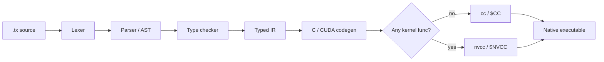

# Trux

**Trux is a small, Go-inspired programming language that compiles to C, and to CUDA when your program has GPU kernels.**

You write `.tx` files with explicit types and a familiar, curly-brace syntax. The `trux` compiler, written in Go, checks them,
turns them into readable C, and hands that C to your system's C compiler (`cc`, or `nvcc` for GPU programs). The result is
an ordinary native executable.

```trux
--8<-- "examples/hello.tx"
```

```console
$ trux run examples/hello.tx
3
```

[Get started](getting-started/index.md){ .md-button .md-button--primary }
[Tour the language](guide/index.md){ .md-button }
[See examples](examples.md){ .md-button }

---

<div class="grid cards" markdown>

-   :material-rocket-launch:{ .lg .middle } **Getting started**

    ---

    Build the compiler from source and run your first program in a couple of minutes.

    [:octicons-arrow-right-24: Install and build](getting-started/install.md)

-   :material-book-open-variant:{ .lg .middle } **Language guide**

    ---

    Types, variables, functions, loops, arrays, slices, lists, modules, and tests, one small step at a time.

    [:octicons-arrow-right-24: Read the guide](guide/index.md)

-   :material-expansion-card-variant:{ .lg .middle } **GPU programming**

    ---

    Write `kernel func` in Trux, move data with `gpu.from` and `gpu.to`, and launch over 1D or 2D grids.

    [:octicons-arrow-right-24: GPU guide](guide/gpu.md)

-   :material-package-variant:{ .lg .middle } **Standard library**

    ---

    Small built-in packages for stdin and files (`io`), CSV (`csv`), PPM images (`image`), clocks (`time`), and HTTP servers (`http`).

    [:octicons-arrow-right-24: Packages](stdlib/index.md)

-   :material-console:{ .lg .middle } **CLI reference**

    ---

    `trux run`, `build`, `emit-c`, `fmt`, and `test`, with every flag.

    [:octicons-arrow-right-24: Commands](cli.md)

-   :material-cog-transfer:{ .lg .middle } **How it works**

    ---

    Follow a program through the lexer, parser, type checker, typed IR, and the C/CUDA backend.

    [:octicons-arrow-right-24: Internals](internals/index.md)

</div>

## What Trux is (and isn't)

Trux is a **learning compiler**: the whole pipeline is built by hand so that each stage stays small enough to read end to end.
It borrows syntax ideas from Go, but it is **not Go-compatible**.

What you get today:

- Four scalar types (`int`, `float`, `string`, `bool`) and three collection shapes: fixed arrays `[N]T`, slice views `[]T`, and growable lists `list[T]`.
- Explicit everything: every variable and parameter has a written type, and `int` never silently becomes `float`.
- Safety checks in the generated code: integer overflow, division by zero, and out-of-bounds indexing stop the program with a clear `trux runtime error`.
- Arena-based memory with no garbage collector and no manual `free` for host values.
- Multi-file programs with relative imports, `pub func` exports, and package-qualified calls.
- Built-in unit tests (`.test.tx` files and `trux test`).
- CUDA kernels written in Trux itself.

What it doesn't have (yet): structs, maps, generics, user-defined types, type inference, int/float conversions, closures, and
concurrency primitives outside the HTTP server. See the [FAQ](faq.md) for details.

## The pipeline at a glance



Read [Compiling to C and CUDA](internals/compilation.md) for the full story.
