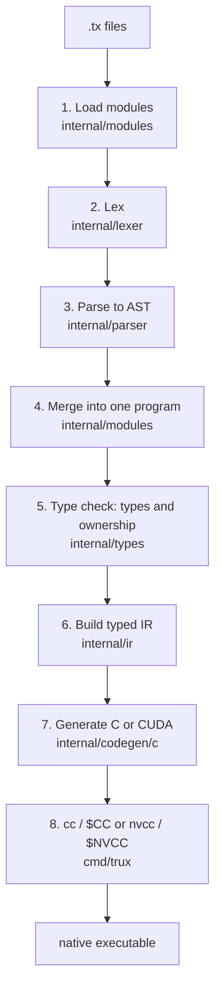

# Compiling to C and CUDA

This page follows a program through the compiler. To watch it happen on your own code, run
`trux run --debug file.tx` and look in `tmp/trux-debug/<name>/` (see the [CLI reference](../cli.md#debug-output)).



## 1. Loading modules

`modules.Load` (in `internal/modules/loader.go`) starts at the entry file and reads every file it imports, transitively:

- Relative `.tx` imports are resolved from the importing file's directory and canonicalized, so each file is loaded once.
- Importing a file also loads its same-directory siblings that declare the same package.
- Bare imports (`"io"`, `"gpu"`, ...) are checked against the list of standard packages; they don't load any files.
- Cycles are detected and reported with the full import chain.

Each file is lexed and parsed separately (steps 2 and 3), then merged (step 4).

## 2. Lexing

`internal/lexer` turns source text into tokens (`internal/token`): keywords, identifiers, integer and float literals,
string literals (with escapes already decoded), operators, and punctuation. Whitespace and `//` comments are skipped.
Every token records its file, line, and column, which is what makes error messages point at the right place.

## 3. Parsing

`internal/parser` is a hand-written recursive-descent parser. Statements are parsed by looking at the first token
(`let`, `return`, `if`, `for`, `break`, `continue`, or else an expression/assignment), and binary expressions use
precedence climbing with five levels (`||`, `&&`, comparisons and `in`, `+ -`, `* / %`). The result is an AST
(`internal/ast`): a `Program` with a package name, imports, and function declarations.

## 4. Merging into one program

Back in the loader, the parsed files are validated and merged:

- calls are checked against visibility rules (`pub` vs package-private, direct imports only),
- qualified calls such as `math.add` are resolved to the function they name,
- private functions are given compiler-unique internal names (prefixed `__trux_`) so two packages can each have their
  own `value()` helper,
- everything is merged into a single flat `ast.Program`.

This "name hygiene" trick lets the rest of the compiler work on one program, as if it had been written in one file. The
trade-offs are discussed in [Modules design](../MODULES.md).

## 5. Type checking

`types.Check` (in `internal/types/types.go`) walks every function and:

- assigns a type to every expression and checks every rule from the [language guide](../guide/index.md): exact type
  matches, `bool` conditions, argument counts and types, `main() int`, return on all paths, `break` only in loops, and so
  on;
- resolves every call to a user function, a builtin (`print`, `len`, `append`, ...), or a standard package member;
- tracks the **ownership origin** of every collection and string value: `borrowed` (comes from a non-`mut` parameter),
  `scratch` / `frame-owned` (allocated in this function), `owned`, or `unknown` (returned by a call). This is what
  rejects mutating a borrowed collection and decides when a returned value must be copied. Origins are merged
  correctly across `if` branches and loop exits, including `break` and `continue`;
- checks kernels with a separate, stricter set of rules (only scalars and GPU buffers, no calls except coordinate
  helpers) and records whether each kernel is launched 1D, 2D, or manually.

The result is an `Info` table that maps AST nodes to types, origins, and resolved calls.

## 6. Typed IR

`ir.Build` (in `internal/ir/ir.go`) combines the AST with the `Info` table into a typed intermediate representation. In
the IR:

- every expression carries its type and ownership origin,
- builtins and library calls become dedicated nodes (`PrintStmt` with one type per argument, `AppendStmt`,
  `GPULaunchStmt`, `HTTPServeStmt`, ...),
- kernels are kept separately from host functions, together with how many coordinates the launch injects,
- the set of collection types used by the program is collected, so the backend knows which C types to define.

The code generator only ever reads the IR, never the AST.

## 7. Generating C

`internal/codegen/c` writes one C source file for the whole program.

### Types

| Trux | C |
| --- | --- |
| `int` | `int64_t` |
| `float` | `double` |
| `bool` | `bool` |
| `string` | `rt_string` (`{ const uint8_t* data; size_t len; }`) |
| `[N]int` | `rt_array_int` (`{ int64_t* data; size_t len; }`) |
| `[]float` | `rt_slice_float` |
| `list[string]` | `rt_list_string*` (`{ rt_string* data; size_t len; size_t cap; }`) |
| `list[list[int]]` | `rt_list_list_int*`, a nested family defined in the generated file |
| `gpu.Buffer[int]` | `rt_gpu_buffer_int` on the host, `int64_t*` inside a kernel |

The runtime header defines the array, slice, and list types (and their helper functions) for `int`, `float`, `bool`, and
`string` with one macro, `RT_DEFINE_COLLECTIONS`. For nested collections, the generated file invokes the same macro for
each extra element type it needs, for example `RT_DEFINE_COLLECTIONS(list_int, rt_list_int*)`.

### A worked example

This is `examples/hello.tx`:

```trux
--8<-- "examples/hello.tx"
```

and this is what `trux emit-c examples/hello.tx` produces:

```c
--8<-- "website/outputs/generated/hello.c"
```

Things to notice:

- **Name mangling.** Functions become `trux_f_<length>_<name>` and variables `trux_v_<length>_<name>` (kernels use
  `trux_k_`). User names can never collide with C keywords or runtime helpers.
- **Two hidden parameters.** Every function takes `rt_context* trux_ctx` (the program's runtime state, including the
  durable arena) and `rt_arena* trux_result_arena` (where the caller wants returned values to live).
- **One exit path.** `return` stores into `trux_return_value` and jumps to `trux_return:`, where a function's frame arena
  (if it has one) is released. `rt_runtime_fail("missing return")` guards the impossible fall-through.
- **Checked arithmetic.** `a + b` on `int` becomes `rt_add_i64(a, b)`, which reports overflow. Float arithmetic is plain C.
- **`#line` directives.** They map the C code back to your `.tx` file, so C compiler errors and runtime errors such as
  `integer overflow in +  at main.tx:5` point at Trux source lines. The checked helpers pick up the location through
  `__FILE__` and `__LINE__`.
- **`print`** becomes one runtime call per argument (`rt_print_int`, `rt_print_float`, `rt_print_string`, `rt_print_bool`)
  followed by `rt_print_newline()`.
- **The real `main`** creates the durable arena and the context, calls the Trux `main`, frees everything, and returns
  its value as the exit code.

### Memory in generated code

- Functions that allocate local dynamic values (string concatenation, array or list literals, `make`, `clone`, IO
  results) get a **frame arena**: `rt_arena trux_frame; rt_arena_init_frame(&trux_frame, trux_ctx);` on entry and
  `rt_arena_deinit(&trux_frame);` on exit. Functions that don't allocate skip it.
- Returning a value that lives in the frame copies it into `trux_result_arena`, for example
  `trux_return_value = rt_slice_int_clone(trux_result_arena, ...)`. Returning a view of a parameter does not copy.
- Loops whose allocations cannot escape an iteration take an arena mark at the top of each iteration and rewind to it
  at the end (`rt_arena_mark_current` / `rt_arena_rewind`), so temporary strings built in a loop are reclaimed every
  iteration.
- Arena chunks are recycled through a pool in `rt_context`, so short-lived frame arenas are cheap.

### Other lowering details

- `&&` and `||` short-circuit, and expressions with side effects are evaluated left to right through temporaries.
- Indexing goes through bounds-checked helpers such as `rt_slice_int_get` and `rt_slice_int_set`.
- `assert` reports the Trux file, line, and column on failure.
- Standard library calls become calls to runtime helpers (`io.readLine()` → `rt_read_line`, `time.monotonicNanos()` →
  a monotonic clock helper, and so on).

## 8. Calling the C compiler

`cmd/trux/compile.go` writes the generated file and the runtime headers into a temporary directory (or `out/<name>/` for
`emit-c`) and runs:

| Program | Command |
| --- | --- |
| no kernels | `$CC -std=c11 -O2 main.c -o main` (`-O0` with `--debug`; default `CC=cc`) |
| uses `http` | the same, plus `-pthread`; `trux_http_runtime.h` is included |
| declares a `kernel func` | `$NVCC -x cu main.cu -o main` (default `NVCC=nvcc`) |

The runtime itself is a single header, `trux_runtime.h`, stored as a Go string constant in `internal/runtime/c/rt.go`
(and `http.go` for the HTTP runtime). It's written next to the generated source on every build, so there is nothing to
install or link.

## CUDA output

When a program declares at least one `kernel func`, the generated file is `.cu` and starts with
`#define TRUX_RUNTIME_CUDA 1`, which makes the runtime header include `cuda_runtime.h` and define the GPU helpers.

Each kernel becomes a `__global__` function. Here is the kernel from `examples/gpu_matrix_multiply.tx`:

```trux
--8<-- "examples/gpu_matrix_multiply.tx:15:23"
```

```c
--8<-- "website/outputs/generated/matmul_kernel.cu"
```

- Because the kernel is launched with `gpu.launch2d`, its first two parameters (`row`, `col`) are not real parameters.
  They are computed from `blockIdx`, `blockDim`, and `threadIdx`, and the launch extents are passed as hidden
  `trux_dim_x` / `trux_dim_y` parameters. The body is wrapped in a bounds check, so threads outside the grid do nothing.
- `gpu.Buffer[int]` parameters become raw `int64_t*` device pointers.
- Integer arithmetic still uses `rt_add_i64` and friends. Inside device code (`__CUDA_ARCH__`) those macros switch to
  `__device__` versions that execute a `trap` instruction on overflow instead of printing a message.

On the host side, the launch becomes a CUDA triple-chevron call with the grid computed from the extents, followed by an
error check:

```c
--8<-- "website/outputs/generated/matmul_launch.cu"
```

`gpu.from` becomes an allocation plus a host-to-device copy, `gpu.to` a device-to-host copy, and `gpu.free` a
`cudaFree` wrapper. CUDA API errors are turned into `trux runtime error: CUDA ... failed` messages.

## Formatting and the language server

`internal/formatter` reuses the lexer and parser to pretty-print source (`trux fmt`), and `tooling/lsp` reuses the parser,
module loader, and type checker to publish diagnostics in editors. See the [codebase tour](architecture.md).
