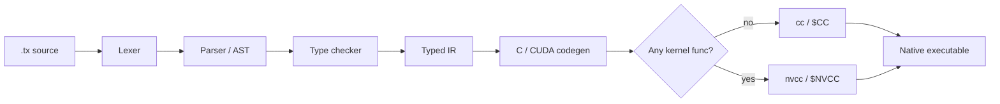

You write `.tx` files with explicit types and a familiar, curly-brace syntax. The `trux` compiler, written in Go, checks them,
turns them into readable C, and hands that C to your system's C compiler (`cc`, or `nvcc` for GPU programs). The result is
an ordinary native executable.



```shell-session
$ trux run examples/hello.tx
3
```

New here? Start with [Getting started](/docs/getting-started/), then take the [language guide](/docs/guide/) one page at a
time. The [How it works](/docs/internals/) section explains the compiler itself and can wait until you are curious.

## What Trux is (and isn't)

Trux is a **learning compiler**: the whole pipeline is built by hand so that each stage stays small enough to read end to end.
It borrows syntax ideas from Go, but it is **not Go-compatible**.

What you get today:

- Four scalar types (`int`, `float`, `string`, `bool`) and three collection shapes: fixed arrays `[N]T`, slice views `[]T`, and growable lists `list[T]`.
- Explicit everything: every variable and parameter has a written type, and `int` never silently becomes `float`.
- Safety checks in the generated code: integer overflow, division by zero, and out-of-bounds indexing stop the program with a clear `trux runtime error`.
- Arena-based memory with no garbage collector and no manual `free` for host values.
- Multi-file programs with relative imports, `pub func` exports, and package-qualified calls.
- Built-in unit tests (`.test.tx` files and `trux test`).
- CUDA kernels written in Trux itself.

What it doesn't have (yet): structs, maps, generics, user-defined types, type inference, int/float conversions, closures, and
concurrency primitives outside the HTTP server. See the [FAQ](/docs/faq/) for details.

## The pipeline at a glance



Read [Compiling to C and CUDA](/docs/internals/compilation/) for the full story.
