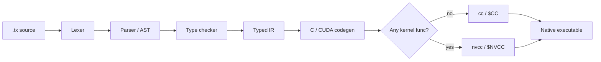

**Trux is a small, explicitly typed language that compiles to readable C**, and to CUDA when a program has GPU kernels.
The `trux` compiler, written in Go, checks your `.tx` files, generates C, and builds a native executable with `cc` (or
`nvcc`).

**Who it's for:** people who want to see how a compiler works end to end, and to write small CPU and GPU programs
whose generated code they can read. It is a learning project, not a production language.

**Fastest path to a running program** (needs [Go](https://go.dev/dl/) and a C compiler such as `cc`):

```bash
git clone https://github.com/claudioscheer/trux.git && cd trux
go build -o bin/trux ./cmd/trux
./bin/trux run examples/hello.tx
```





Then follow [Your first program](/docs/getting-started/first-program/) and the [language guide](/docs/guide/).

## What you get

- **Explicit types**: `int`, `float`, `string`, `bool`, `error`, structs `type Name struct`, pointers `*T`, arrays `[N]T`,
  slices `[]T`, lists `list[T]`, and maps `map[K]V`. Nothing converts implicitly.
- **Checked at run time**: integer overflow, division by zero, out-of-bounds indexes, nil pointer dereferences, and
  failed `assert`s stop the program with a `trux runtime error`.
- **Arena memory**: no garbage collector and no manual `free` for host values; `mut` parameters, pointers, `new(T)`, and
  `clone` make every change to shared data visible.
- **Multi-file programs** with relative imports, `pub func`, and `pub type ... struct`.
- **Built-in tests**: `.test.tx` files and `trux test`.
- **GPU kernels** written in Trux and compiled to CUDA.
- A small standard library: `io`, `csv`, `image`, `time`, `http`, `gpu`, and `errors`.

**Not there yet:** generics, interfaces, type inference, `int`/`float` conversions, closures, and concurrency outside the
HTTP server. See the [FAQ](/docs/faq/#whats-missing).

## How it works



Each stage is small enough to read; [How it works](/docs/internals/) walks through them.
