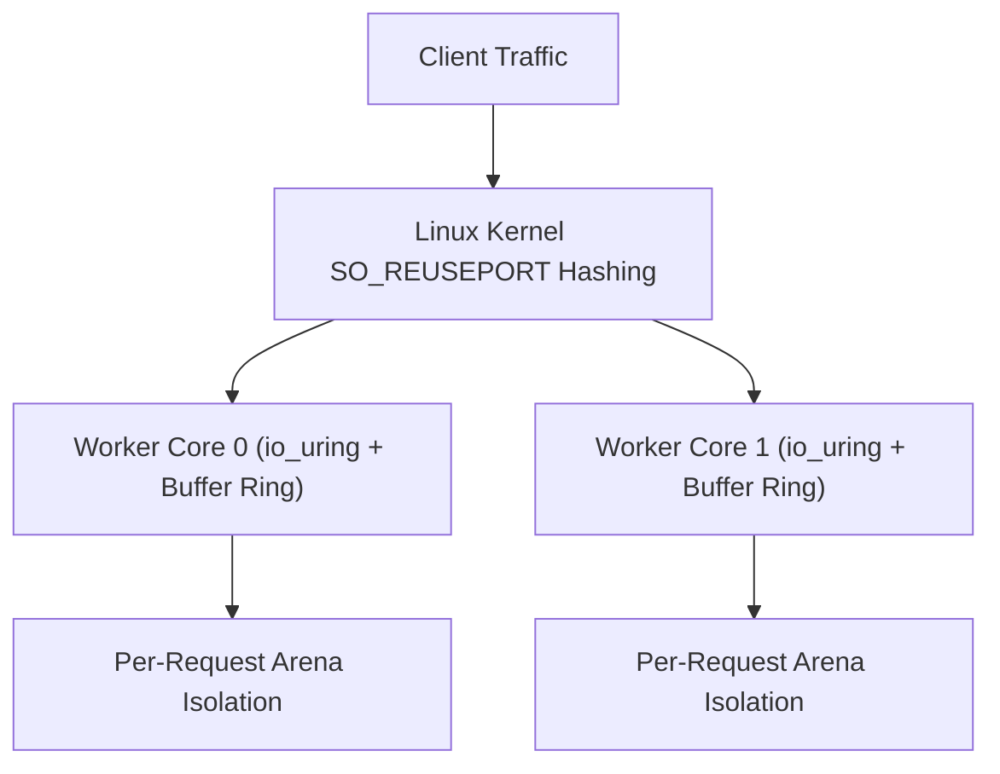

Trux features a high-performance HTTP engine engineered specifically for Linux servers. It is built natively on **`io_uring`** and **`liburing`**, departing from legacy `epoll` architectures and goroutine schedulers in favor of a shared-nothing, thread-per-core model.

## Architecture Highlights

- **Shared-Nothing Thread-per-Core**: Each hardware execution unit runs an independent worker thread. Every worker creates its own listening socket with `SO_REUSEPORT`, dedicated `io_uring` instance, and dedicated kernel buffer ring.
- **Kernel Buffer Rings (`io_uring_register_buf_ring`)**: The Linux kernel dynamically selects pre-registered buffers upon incoming network packets (`IOSQE_BUFFER_SELECT`), eliminating user-space memory allocations and read system calls.
- **Multishot Operations**: A single Submission Queue Entry (SQE) establishes continuous connection acceptance (`io_uring_prep_multishot_accept`) and streaming receive (`io_uring_prep_recv_multishot`) for the lifetime of connections.
- **Vectorized Scatter-Gather Responses**: HTTP headers and payloads are emitted through vectorized I/O (`writev`), preventing memory copies.
- **Predictable Memory Footprint**: Bounded buffer rings and request-scoped arenas keep memory consumption flat (< 100 MiB) regardless of concurrent connection counts.



---

## Test Environment & Methodology

Benchmarks were conducted using the standard HTTP benchmarking utility [`wrk`](https://github.com/wg/wrk) against containerized Trux servers run under strict Linux cgroup hardware limits:

- **Host OS & Kernel**: Ubuntu 24.04 LTS on Linux 6.18 (`x86_64`)
- **Container Runtime**: Docker Engine 29.1 (cgroup v2, `--security-opt seccomp=unconfined`, `--ulimit memlock=-1:-1`)
- **Libraries**: `liburing2` v2.5
- **Connections**: 100 and 1,000 persistent HTTP/1.1 keep-alive connections
- **Duration**: 6 seconds per scenario

### Workloads Evaluated

1. **Plaintext (`/plaintext`)**: Raw HTTP/1.1 framing and minimal response body (`"Hello, World!"`), measuring peak kernel network I/O with zero database overhead.
2. **SQLite File Insert & Query (`/json`)**: Real on-disk SQLite WAL database file (`/tmp/bench.db`) write transaction: appends an access log entry (`INSERT INTO logs`), queries the latest row (`SELECT`), and serializes JSON.
3. **SQLite File Prepared Query (`/users/1024`)**: Concurrent reads on disk: extracts route parameter (`:id`), compiles a prepared SQL statement (`SELECT name, role FROM users WHERE id = ?`), binds parameters (`bindText`), steps the cursor, and returns JSON.
4. **Middleware & SQLite File Audit (`/api/data`)**: Prefix middleware (`useAt`), Bearer token validation, on-disk SQLite WAL audit log insertion, request-scoped context dictionary propagation, and privileged JSON response delivery.

---

## Benchmark Results

### 1. Micro Edge (1 vCPU, 256 MB RAM)

Simulates constrained edge environments, micro instances, or single-core serverless containers (`--cpuset-cpus="0" --cpus="1.0" --memory="256m"`).

| Endpoint | Concurrency | Throughput (req/s) | Transfer | Avg Latency | p50 | p90 | p99 | Memory |
| :--- | :---: | :---: | :---: | :---: | :---: | :---: | :---: | :---: |
| **Plaintext** (`/plaintext`) | 100 | **163,983** | 16.11 MB/s | 1.06 ms | 497 µs | 1.25 ms | 12.90 ms | 91.8 MiB |
| **Plaintext** (`/plaintext`) | 1,000 | **184,936** | 18.17 MB/s | 6.04 ms | 5.44 ms | 12.94 ms | 23.88 ms | 95.4 MiB |
| **SQLite File Insert & Query** (`/json`) | 100 | **1,451** | 201.0 KB/s | 74.00 ms | 2.81 ms | 85.44 ms | 1.40 s | 99.8 MiB |
| **SQLite File Insert & Query** (`/json`) | 1,000 | **1,443** | 201.4 KB/s | 82.11 ms | 33.28 ms | 45.37 ms | 1.52 s | 104.1 MiB |
| **SQLite File Prepared Query** (`/users/1024`) | 100 | **110,870** | 14.80 MB/s | 880 µs | 731 µs | 1.58 ms | 3.40 ms | 104.7 MiB |
| **SQLite File Prepared Query** (`/users/1024`) | 1,000 | **108,854** | 14.53 MB/s | 15.12 ms | 8.38 ms | 43.33 ms | 82.83 ms | 108.4 MiB |
| **Middleware & SQLite File Audit** (`/api/data`) | 100 | **1,555** | 211.1 KB/s | 13.04 ms | 3.16 ms | 3.95 ms | 373.49 ms | 109.0 MiB |
| **Middleware & SQLite File Audit** (`/api/data`) | 1,000 | **1,547** | 210.0 KB/s | 46.95 ms | 30.24 ms | 33.83 ms | 871.78 ms | 113.3 MiB |

---

### 2. Cloud Standard (2 vCPUs, 1 GB RAM)

Simulates standard dual-core virtual machines (`--cpuset-cpus="0,1" --cpus="2.0" --memory="1g"`).

| Endpoint | Concurrency | Throughput (req/s) | Transfer | Avg Latency | p50 | p90 | p99 | Memory |
| :--- | :---: | :---: | :---: | :---: | :---: | :---: | :---: | :---: |
| **Plaintext** (`/plaintext`) | 100 | **184,787** | 18.15 MB/s | 970 µs | 436 µs | 1.20 ms | 5.19 ms | 91.4 MiB |
| **Plaintext** (`/plaintext`) | 1,000 | **325,641** | 31.99 MB/s | 3.75 ms | 2.82 ms | 8.32 ms | 19.40 ms | 95.5 MiB |
| **SQLite File Insert & Query** (`/json`) | 100 | **1,370** | 189.8 KB/s | 134.68 ms | 4.49 ms | 544.89 ms | 1.31 s | 101.0 MiB |
| **SQLite File Insert & Query** (`/json`) | 1,000 | **1,433** | 199.9 KB/s | 266.85 ms | 36.82 ms | 1.04 s | 1.92 s | 105.9 MiB |
| **SQLite File Prepared Query** (`/users/1024`) | 100 | **127,252** | 16.99 MB/s | 589 µs | 451 µs | 1.14 ms | 2.49 ms | 105.7 MiB |
| **SQLite File Prepared Query** (`/users/1024`) | 1,000 | **188,125** | 25.12 MB/s | 4.47 ms | 3.38 ms | 9.98 ms | 19.61 ms | 109.1 MiB |
| **Middleware & SQLite File Audit** (`/api/data`) | 100 | **1,504** | 204.1 KB/s | 51.11 ms | 3.20 ms | 42.26 ms | 961.91 ms | 109.4 MiB |
| **Middleware & SQLite File Audit** (`/api/data`) | 1,000 | **1,579** | 214.4 KB/s | 84.38 ms | 32.23 ms | 45.35 ms | 1.53 s | 113.2 MiB |

---

### 3. Compute Node (4 vCPUs, 2 GB RAM)

Simulates multi-core production server nodes (`--cpuset-cpus="0,1,2,3" --cpus="4.0" --memory="2g"`).

| Endpoint | Concurrency | Throughput (req/s) | Transfer | Avg Latency | p50 | p90 | p99 | Memory |
| :--- | :---: | :---: | :---: | :---: | :---: | :---: | :---: | :---: |
| **Plaintext** (`/plaintext`) | 100 | **244,235** | 23.99 MB/s | 990 µs | 308 µs | 1.08 ms | 15.81 ms | 91.8 MiB |
| **Plaintext** (`/plaintext`) | 1,000 | **428,091** | 42.05 MB/s | 2.62 ms | 1.78 ms | 5.75 ms | 12.83 ms | 95.9 MiB |
| **SQLite File Insert & Query** (`/json`) | 100 | **1,433** | 198.6 KB/s | 119.52 ms | 3.46 ms | 457.03 ms | 1.63 s | 98.2 MiB |
| **SQLite File Insert & Query** (`/json`) | 1,000 | **1,395** | 194.6 KB/s | 149.20 ms | 35.61 ms | 417.99 ms | 1.48 s | 101.8 MiB |
| **SQLite File Prepared Query** (`/users/1024`) | 100 | **86,035** | 11.49 MB/s | 505 µs | 354 µs | 990 µs | 2.61 ms | 102.3 MiB |
| **SQLite File Prepared Query** (`/users/1024`) | 1,000 | **292,992** | 39.12 MB/s | 1.81 ms | 1.23 ms | 4.02 ms | 7.89 ms | 104.5 MiB |
| **Middleware & SQLite File Audit** (`/api/data`) | 100 | **1,459** | 198.1 KB/s | 110.74 ms | 3.74 ms | 459.71 ms | 1.43 s | 105.3 MiB |
| **Middleware & SQLite File Audit** (`/api/data`) | 1,000 | **1,517** | 205.9 KB/s | 84.35 ms | 28.53 ms | 39.52 ms | 1.66 s | 106.5 MiB |

---

## Analysis & Key Takeaways

### Realistic On-Disk Database Workloads
The benchmark operates against an actual persistent database file on disk (`/tmp/bench.db`) configured with SQLite's recommended Write-Ahead Logging mode (`PRAGMA journal_mode=WAL; PRAGMA synchronous=NORMAL;`).

### Thread-Local Connection Architecture (`sqlite.openThreadLocal`)
Handlers utilize thread-local connection caching. Each `io_uring` worker thread initializes a dedicated connection handle on its first request and reuses it for all subsequent operations:
- **Zero File Descriptor Churn**: Eliminates file open/close syscalls and repeated schema parsing per request.
- **Lock-Free Concurrency**: Each worker thread accesses its own handle exclusively, eliminating connection-level mutex contention.
- **Safe Resource Lifecycle**: Closing a thread-local handle resets prepared statements while keeping the underlying connection active.

### Concurrent Readers vs. Serialized Disk Writes
- **High-Throughput Reads (`/users/1024`)**: Because WAL mode allows readers to run concurrently without taking exclusive locks, parameterized prepared queries achieve **108,000 to 292,992 req/s** on disk with median latency of **1.23 ms** under 1,000 concurrency across 4 cores.
- **Physical Disk Write Limits (`/json`, `/api/data`)**: SQLite serializes write transactions to guarantee ACID durability. Thread-local connection reuse doubles write throughput from ~780 to **~1,500+ writes/sec** by removing file open overhead.
- **Zero Lock Failures**: Thanks to `sqlite3_busy_timeout` queueing, zero requests failed with `database is locked` despite 1,000 simultaneous concurrent writers.

### Bounded Memory Stability Under Continuous I/O
Across hundreds of thousands of concurrent database transactions, container memory remains bounded between **91 MiB and 113 MiB**. Lock-free handle management and explicit resource closing eliminate heap bloat and guarantee long-running stability without garbage collection pauses.

---

## Reproducing the Benchmarks

The benchmark harness and server source code are located in `benchmarks/http/`:

```bash
# Compile and run the benchmark suite against Docker containers
python3 benchmarks/http/benchmark.py
```

The script compiles the Trux HTTP server, builds the runtime Docker container, executes `wrk` across all hardware profiles, and generates `BENCHMARK_RESULTS.md` and `results.json`.
