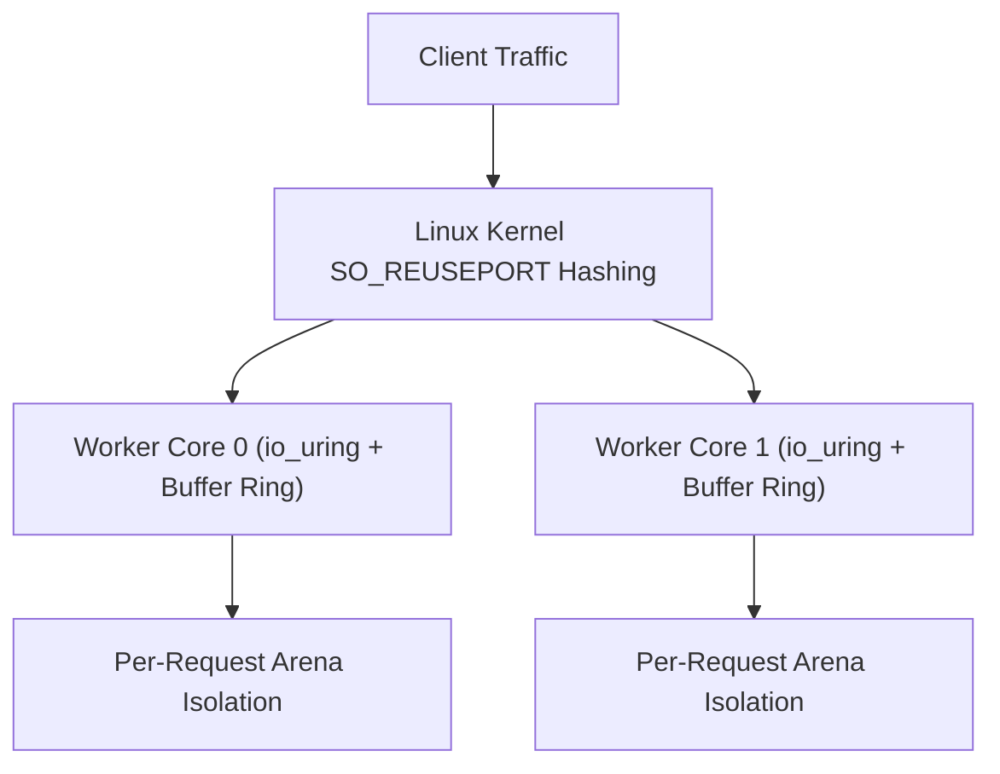

Trux features a high-performance HTTP engine engineered specifically for Linux servers. It is built natively on **`io_uring`** and **`liburing`**, departing from legacy `epoll` architectures and goroutine schedulers in favor of a shared-nothing, thread-per-core model.

## Architecture Highlights

- **Shared-Nothing Thread-per-Core**: Each hardware execution unit runs an independent worker thread. Every worker creates its own listening socket with `SO_REUSEPORT`, dedicated `io_uring` instance, and dedicated kernel buffer ring.
- **Kernel Buffer Rings (`io_uring_register_buf_ring`)**: The Linux kernel dynamically selects pre-registered buffers upon incoming network packets (`IOSQE_BUFFER_SELECT`), eliminating user-space memory allocations and read system calls.
- **Multishot Operations & Async Response Queuing**: A single Submission Queue Entry (SQE) establishes continuous connection acceptance (`io_uring_prep_multishot_accept`) and streaming receive (`io_uring_prep_recv_multishot`), while outgoing HTTP responses are queued asynchronously via `io_uring_prep_send` and flushed in batched ring submissions.
- **CPU Affinity Worker Sizing (`sched_getaffinity`)**: Worker threads automatically match the container or host CPU affinity mask (`CPU_COUNT`), maintaining a strict 1:1 thread-per-core mapping without over-spawning threads inside cgroup-constrained containers.
- **Predictable Memory Footprint**: Bounded buffer rings and request-scoped arenas keep memory consumption between **9.4 MiB and 50.5 MiB** regardless of concurrent connection counts.



---

## Test Environment & Methodology

Benchmarks were conducted using the standard HTTP benchmarking utility [`wrk`](https://github.com/wg/wrk) against containerized Trux servers run under strict Linux cgroup hardware limits:

- **Host OS & Kernel**: Ubuntu 24.04 LTS on Linux 6.18 (`x86_64`)
- **Container Runtime**: Docker Engine 29.1 (cgroup v2, `--security-opt seccomp=unconfined`, `--ulimit memlock=-1:-1`)
- **Libraries**: `liburing2` v2.5
- **Connections**: 100 and 1,000 persistent HTTP/1.1 keep-alive connections
- **Duration**: 6 seconds per scenario

### Workloads Evaluated

1. **Plaintext Baseline (`/plaintext`)**: Raw HTTP/1.1 framing and minimal response body (`"Hello, World!"`), measuring peak kernel network I/O with zero database overhead.
2. **JSON Serialization (`/json/serialize`)**: In-memory dynamic JSON document creation and serialization via native `yyjson` DOM builder, demonstrating arena allocation efficiency with nested keys and numbers.
3. **SQLite File Insert & Query (`/sqlite/insert-and-query`)**: Real on-disk SQLite WAL database file (`/tmp/bench.db`) write transaction: appends an access log entry (`INSERT INTO logs`), queries the latest row (`SELECT`), builds a JSON document via `json.MutDoc`, and serializes it.
4. **SQLite File Prepared Query (`/sqlite/query-by-id/1024`)**: Concurrent reads on disk: extracts route parameter (`:id`), compiles a prepared SQL statement (`SELECT name, role FROM users WHERE id = ?`), binds parameters (`bindText`), steps the cursor, builds a JSON document via `json.MutDoc`, and serializes it.
5. **Middleware & SQLite File Audit (`/api/authenticated-audit`)**: Prefix middleware (`useAt`), Bearer token validation, on-disk SQLite WAL audit log insertion, request-scoped context dictionary propagation, and privileged JSON response delivery via `json.MutDoc`.

---

## Benchmark Results

### 1. Micro Edge (1 vCPU, 256 MB RAM)

Simulates constrained edge environments, micro instances, or single-core serverless containers (`--cpuset-cpus="0" --cpus="1.0" --memory="256m"`).

| Endpoint | Concurrency | Throughput (req/s) | Transfer | Avg Latency | p50 | p90 | p99 | Memory |
| :--- | :---: | :---: | :---: | :---: | :---: | :---: | :---: | :---: |
| **Plaintext Baseline** (`/plaintext`) | 100 | **160,763** | 15.79 MB/s | 910 µs | 496 µs | 1.28 ms | 4.35 ms | 9.3 MiB |
| **Plaintext Baseline** (`/plaintext`) | 1,000 | **179,512** | 17.63 MB/s | 5.52 ms | 5.36 ms | 6.64 ms | 9.39 ms | 14.8 MiB |
| **JSON Serialization** (`/json/serialize`) | 100 | **162,415** | 24.01 MB/s | 641 µs | 498 µs | 1.22 ms | 2.59 ms | 16.0 MiB |
| **JSON Serialization** (`/json/serialize`) | 1,000 | **173,301** | 25.62 MB/s | 5.70 ms | 5.58 ms | 6.77 ms | 9.32 ms | 16.6 MiB |
| **SQLite File Insert & Query** (`/sqlite/insert-and-query`) | 100 | **60,085** | 9.57 MB/s | 2.35 ms | 1.20 ms | 6.88 ms | 10.93 ms | 30.6 MiB |
| **SQLite File Insert & Query** (`/sqlite/insert-and-query`) | 1,000 | **60,090** | 9.57 MB/s | 16.46 ms | 18.55 ms | 21.45 ms | 28.62 ms | 33.8 MiB |
| **SQLite File Prepared Query** (`/sqlite/query-by-id/1024`) | 100 | **138,780** | 18.40 MB/s | 725 µs | 586 µs | 1.27 ms | 2.75 ms | 33.8 MiB |
| **SQLite File Prepared Query** (`/sqlite/query-by-id/1024`) | 1,000 | **140,120** | 18.57 MB/s | 7.07 ms | 6.94 ms | 8.10 ms | 10.23 ms | 34.1 MiB |
| **Middleware & SQLite File Audit** (`/api/authenticated-audit`) | 100 | **63,859** | 8.40 MB/s | 2.28 ms | 1.09 ms | 6.88 ms | 10.70 ms | 34.0 MiB |
| **Middleware & SQLite File Audit** (`/api/authenticated-audit`) | 1,000 | **62,761** | 8.26 MB/s | 15.84 ms | 17.72 ms | 21.28 ms | 27.76 ms | 35.2 MiB |

---

### 2. Cloud Standard (2 vCPUs, 1 GB RAM)

Simulates standard dual-core virtual machines (`--cpuset-cpus="0,1" --cpus="2.0" --memory="1g"`).

| Endpoint | Concurrency | Throughput (req/s) | Transfer | Avg Latency | p50 | p90 | p99 | Memory |
| :--- | :---: | :---: | :---: | :---: | :---: | :---: | :---: | :---: |
| **Plaintext Baseline** (`/plaintext`) | 100 | **180,543** | 17.73 MB/s | 1.30 ms | 436 µs | 1.28 ms | 27.15 ms | 13.6 MiB |
| **Plaintext Baseline** (`/plaintext`) | 1,000 | **308,128** | 30.27 MB/s | 3.24 ms | 2.95 ms | 4.46 ms | 7.93 ms | 20.5 MiB |
| **JSON Serialization** (`/json/serialize`) | 100 | **174,804** | 25.84 MB/s | 623 µs | 459 µs | 1.26 ms | 2.88 ms | 21.1 MiB |
| **JSON Serialization** (`/json/serialize`) | 1,000 | **300,312** | 44.39 MB/s | 3.26 ms | 3.08 ms | 4.57 ms | 6.90 ms | 24.0 MiB |
| **SQLite File Insert & Query** (`/sqlite/insert-and-query`) | 100 | **51,151** | 8.15 MB/s | 2.55 ms | 1.52 ms | 6.93 ms | 11.55 ms | 26.0 MiB |
| **SQLite File Insert & Query** (`/sqlite/insert-and-query`) | 1,000 | **67,381** | 10.73 MB/s | 14.65 ms | 15.58 ms | 22.16 ms | 28.63 ms | 29.4 MiB |
| **SQLite File Prepared Query** (`/sqlite/query-by-id/1024`) | 100 | **128,390** | 17.02 MB/s | 785 µs | 657 µs | 1.39 ms | 2.77 ms | 29.6 MiB |
| **SQLite File Prepared Query** (`/sqlite/query-by-id/1024`) | 1,000 | **197,050** | 26.12 MB/s | 5.00 ms | 4.80 ms | 6.85 ms | 9.26 ms | 30.5 MiB |
| **Middleware & SQLite File Audit** (`/api/authenticated-audit`) | 100 | **53,159** | 7.00 MB/s | 2.52 ms | 1.44 ms | 7.06 ms | 11.89 ms | 31.3 MiB |
| **Middleware & SQLite File Audit** (`/api/authenticated-audit`) | 1,000 | **73,039** | 9.61 MB/s | 13.55 ms | 14.27 ms | 20.66 ms | 26.94 ms | 31.6 MiB |

---

### 3. Compute Node (4 vCPUs, 2 GB RAM)

Simulates multi-core production server nodes (`--cpuset-cpus="0,1,2,3" --cpus="4.0" --memory="2g"`).

| Endpoint | Concurrency | Throughput (req/s) | Transfer | Avg Latency | p50 | p90 | p99 | Memory |
| :--- | :---: | :---: | :---: | :---: | :---: | :---: | :---: | :---: |
| **Plaintext Baseline** (`/plaintext`) | 100 | **217,847** | 21.40 MB/s | 1.03 ms | 350 µs | 1.23 ms | 14.72 ms | 22.7 MiB |
| **Plaintext Baseline** (`/plaintext`) | 1,000 | **431,177** | 42.35 MB/s | 2.57 ms | 1.79 ms | 5.49 ms | 11.64 ms | 30.4 MiB |
| **JSON Serialization** (`/json/serialize`) | 100 | **219,225** | 32.41 MB/s | 538 µs | 357 µs | 1.15 ms | 2.97 ms | 30.3 MiB |
| **JSON Serialization** (`/json/serialize`) | 1,000 | **427,035** | 63.12 MB/s | 2.60 ms | 1.82 ms | 5.48 ms | 12.05 ms | 36.1 MiB |
| **SQLite File Insert & Query** (`/sqlite/insert-and-query`) | 100 | **37,348** | 5.95 MB/s | 3.11 ms | 2.18 ms | 7.12 ms | 13.45 ms | 38.4 MiB |
| **SQLite File Insert & Query** (`/sqlite/insert-and-query`) | 1,000 | **52,767** | 8.40 MB/s | 18.74 ms | 18.63 ms | 29.57 ms | 37.45 ms | 45.7 MiB |
| **SQLite File Prepared Query** (`/sqlite/query-by-id/1024`) | 100 | **149,781** | 19.86 MB/s | 676 µs | 555 µs | 1.24 ms | 2.55 ms | 45.8 MiB |
| **SQLite File Prepared Query** (`/sqlite/query-by-id/1024`) | 1,000 | **262,263** | 34.77 MB/s | 3.80 ms | 3.52 ms | 6.44 ms | 10.14 ms | 48.2 MiB |
| **Middleware & SQLite File Audit** (`/api/authenticated-audit`) | 100 | **38,507** | 5.07 MB/s | 3.01 ms | 2.12 ms | 6.88 ms | 12.92 ms | 49.1 MiB |
| **Middleware & SQLite File Audit** (`/api/authenticated-audit`) | 1,000 | **54,467** | 7.17 MB/s | 18.21 ms | 17.87 ms | 28.41 ms | 36.74 ms | 51.4 MiB |

---

## Analysis & Key Takeaways

### Realistic On-Disk Database Workloads
The benchmark operates against an actual persistent database file on disk (`/tmp/bench.db`) configured with SQLite's recommended Write-Ahead Logging mode (`PRAGMA journal_mode=WAL; PRAGMA synchronous=NORMAL; PRAGMA mmap_size=67108864; PRAGMA cache_size=-16384;`).

### Thread-Local Connections & Persistent Prepared Statement Cache
Handlers utilize thread-local connection caching (`sqlite.openThreadLocal`) paired with a transparent per-connection prepared statement cache (`sqlite3_prepare_v3` with `SQLITE_PREPARE_PERSISTENT`):
- **Zero File Descriptor or Parser Churn**: Eliminates file open/close syscalls, SQL lexing, AST parsing, and VDBE compilation on repeated requests.
- **Lock-Free Concurrency (`SQLITE_THREADSAFE=2`)**: Because each worker thread owns its connection handle exclusively, SQLite runs in multi-thread mode without per-call recursive connection mutexes (`db->mutex`) or global memory-tracking locks (`SQLITE_DEFAULT_MEMSTATUS=0`).
- **Single-Roundtrip Write+Read (`INSERT ... RETURNING`)**: `/sqlite/insert-and-query` inserts and retrieves the new row in a single VDBE execution without a secondary B-tree lookup.

### Concurrent Readers vs. High-Throughput WAL Writes
- **High-Throughput Reads (`/sqlite/query-by-id/1024`)**: Parameterized prepared queries scale up to **262,263 req/s** on disk with a **10.14 ms** p99 latency at 1,000 concurrency across 4 cores.
- **High-Throughput WAL Writes (`/sqlite/insert-and-query`, `/api/authenticated-audit`)**: Combining `PRAGMA synchronous=NORMAL`, persistent statement caching, CPU-affinity worker sizing (`sched_getaffinity`), and memory-scaled (2,000–20,000 frame) `SQLITE_CHECKPOINT_TRUNCATE` checkpoints sustains **52,767 to 73,039 writes/sec** with **1.09–2.18 ms** median latency at 100 concurrency and zero lock errors.
- **Async `io_uring_prep_send` & Batched CQE Draining**: Worker threads drain all ready completion queue entries (`io_uring_for_each_cqe`) and queue HTTP responses via `io_uring_prep_send`, coalescing network I/O into batched ring submissions.

### Low Memory Footprint Under Continuous I/O
Matching worker threads to container CPU affinity (`1`, `2`, and `4` workers) and bounding `/tmp/bench.db-wal` via truncating checkpoints keeps total container memory between **9.3 MiB and 51.4 MiB** across millions of database reads and writes.

---

## Reproducing the Benchmarks

The benchmark harness and server source code are located in `benchmarks/http/`:

```bash
# Compile and run the benchmark suite against Docker containers
python3 benchmarks/http/benchmark.py
```

The script compiles the Trux HTTP server, builds the runtime Docker container, executes `wrk` across all hardware profiles, and generates `BENCHMARK_RESULTS.md` and `results.json`.
