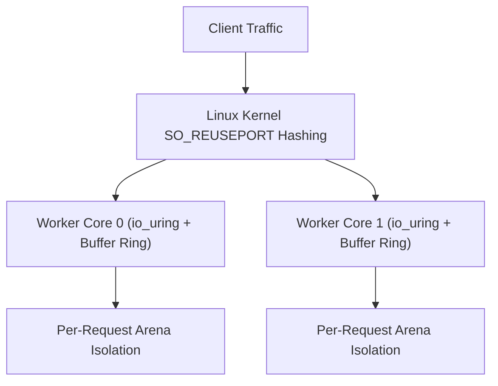

Trux features a high-performance HTTP engine engineered specifically for Linux servers. It is built natively on **`io_uring`** and **`liburing`**, departing from legacy `epoll` architectures and goroutine schedulers in favor of a shared-nothing, thread-per-core model.

## Architecture Highlights

- **Shared-Nothing Thread-per-Core**: Each hardware execution unit runs an independent worker thread. Every worker creates its own listening socket with `SO_REUSEPORT`, dedicated `io_uring` instance, and dedicated kernel buffer ring.
- **Kernel Buffer Rings (`io_uring_register_buf_ring`)**: The Linux kernel dynamically selects pre-registered buffers upon incoming network packets (`IOSQE_BUFFER_SELECT`), eliminating user-space memory allocations and read system calls.
- **Multishot Operations**: A single Submission Queue Entry (SQE) establishes continuous connection acceptance (`io_uring_prep_multishot_accept`) and streaming receive (`io_uring_prep_recv_multishot`) for the lifetime of connections.
- **Vectorized Scatter-Gather Responses**: HTTP headers and payloads are emitted through vectorized I/O (`writev`), preventing memory copies.
- **Predictable Memory Footprint**: Bounded buffer rings and request-scoped arenas keep memory consumption flat (< 100 MiB) regardless of concurrent connection counts.



---

## Test Environment & Methodology

Benchmarks were conducted using the standard HTTP benchmarking utility [`wrk`](https://github.com/wg/wrk) against containerized Trux servers run under strict Linux cgroup hardware limits:

- **Host OS & Kernel**: Ubuntu 24.04 LTS on Linux 6.18 (`x86_64`)
- **Container Runtime**: Docker Engine 29.1 (cgroup v2, `--security-opt seccomp=unconfined`, `--ulimit memlock=-1:-1`)
- **Libraries**: `liburing2` v2.5
- **Connections**: 100 and 1,000 persistent HTTP/1.1 keep-alive connections
- **Duration**: 6 seconds per scenario

### Workloads Evaluated

1. **Plaintext Baseline (`/plaintext`)**: Raw HTTP/1.1 framing and minimal response body (`"Hello, World!"`), measuring peak kernel network I/O with zero database overhead.
2. **SQLite File Insert & Query (`/sqlite/insert-and-query`)**: Real on-disk SQLite WAL database file (`/tmp/bench.db`) write transaction: appends an access log entry (`INSERT INTO logs`), queries the latest row (`SELECT`), and serializes JSON.
3. **SQLite File Prepared Query (`/sqlite/query-by-id/1024`)**: Concurrent reads on disk: extracts route parameter (`:id`), compiles a prepared SQL statement (`SELECT name, role FROM users WHERE id = ?`), binds parameters (`bindText`), steps the cursor, and returns JSON.
4. **Middleware & SQLite File Audit (`/api/authenticated-audit`)**: Prefix middleware (`useAt`), Bearer token validation, on-disk SQLite WAL audit log insertion, request-scoped context dictionary propagation, and privileged JSON response delivery.

---

## Benchmark Results

### 1. Micro Edge (1 vCPU, 256 MB RAM)

Simulates constrained edge environments, micro instances, or single-core serverless containers (`--cpuset-cpus="0" --cpus="1.0" --memory="256m"`).

| Endpoint | Concurrency | Throughput (req/s) | Transfer | Avg Latency | p50 | p90 | p99 | Memory |
| :--- | :---: | :---: | :---: | :---: | :---: | :---: | :---: | :---: |
| **Plaintext Baseline** (`/plaintext`) | 100 | **173,596** | 17.05 MB/s | 0.99 ms | 476 µs | 1.15 ms | 10.40 ms | 91.7 MiB |
| **Plaintext Baseline** (`/plaintext`) | 1,000 | **179,170** | 17.60 MB/s | 6.39 ms | 5.51 ms | 13.83 ms | 27.01 ms | 94.9 MiB |
| **SQLite File Insert & Query** (`/sqlite/insert-and-query`) | 100 | **37,405** | 5.99 MB/s | 3.54 ms | 1.83 ms | 9.09 ms | 20.55 ms | 99.8 MiB |
| **SQLite File Insert & Query** (`/sqlite/insert-and-query`) | 1,000 | **38,948** | 6.24 MB/s | 53.53 ms | 17.27 ms | 159.50 ms | 301.04 ms | 103.9 MiB |
| **SQLite File Prepared Query** (`/sqlite/query-by-id/1024`) | 100 | **110,655** | 14.77 MB/s | 797 µs | 643 µs | 1.41 ms | 3.05 ms | 104.1 MiB |
| **SQLite File Prepared Query** (`/sqlite/query-by-id/1024`) | 1,000 | **106,370** | 14.20 MB/s | 14.46 ms | 6.98 ms | 41.78 ms | 81.86 ms | 106.2 MiB |
| **Middleware & SQLite File Audit** (`/api/authenticated-audit`) | 100 | **45,157** | 5.99 MB/s | 3.04 ms | 1.40 ms | 8.18 ms | 17.60 ms | 108.2 MiB |
| **Middleware & SQLite File Audit** (`/api/authenticated-audit`) | 1,000 | **46,486** | 6.16 MB/s | 45.04 ms | 2.86 ms | 135.57 ms | 273.89 ms | 111.0 MiB |

---

### 2. Cloud Standard (2 vCPUs, 1 GB RAM)

Simulates standard dual-core virtual machines (`--cpuset-cpus="0,1" --cpus="2.0" --memory="1g"`).

| Endpoint | Concurrency | Throughput (req/s) | Transfer | Avg Latency | p50 | p90 | p99 | Memory |
| :--- | :---: | :---: | :---: | :---: | :---: | :---: | :---: | :---: |
| **Plaintext Baseline** (`/plaintext`) | 100 | **192,070** | 18.87 MB/s | 764 µs | 430 µs | 1.12 ms | 3.37 ms | 87.7 MiB |
| **Plaintext Baseline** (`/plaintext`) | 1,000 | **322,706** | 31.70 MB/s | 3.79 ms | 2.86 ms | 8.40 ms | 19.24 ms | 95.3 MiB |
| **SQLite File Insert & Query** (`/sqlite/insert-and-query`) | 100 | **38,515** | 6.17 MB/s | 2.81 ms | 1.83 ms | 7.20 ms | 11.37 ms | 101.1 MiB |
| **SQLite File Insert & Query** (`/sqlite/insert-and-query`) | 1,000 | **37,797** | 6.06 MB/s | 23.48 ms | 23.55 ms | 30.91 ms | 41.36 ms | 105.5 MiB |
| **SQLite File Prepared Query** (`/sqlite/query-by-id/1024`) | 100 | **146,633** | 19.58 MB/s | 625 µs | 499 µs | 1.18 ms | 2.45 ms | 104.8 MiB |
| **SQLite File Prepared Query** (`/sqlite/query-by-id/1024`) | 1,000 | **188,478** | 25.16 MB/s | 5.82 ms | 4.40 ms | 12.99 ms | 26.70 ms | 108.7 MiB |
| **Middleware & SQLite File Audit** (`/api/authenticated-audit`) | 100 | **40,513** | 5.37 MB/s | 2.63 ms | 1.59 ms | 7.02 ms | 11.01 ms | 109.2 MiB |
| **Middleware & SQLite File Audit** (`/api/authenticated-audit`) | 1,000 | **41,417** | 5.49 MB/s | 21.12 ms | 21.31 ms | 29.84 ms | 40.09 ms | 111.6 MiB |

---

### 3. Compute Node (4 vCPUs, 2 GB RAM)

Simulates multi-core production server nodes (`--cpuset-cpus="0,1,2,3" --cpus="4.0" --memory="2g"`).

| Endpoint | Concurrency | Throughput (req/s) | Transfer | Avg Latency | p50 | p90 | p99 | Memory |
| :--- | :---: | :---: | :---: | :---: | :---: | :---: | :---: | :---: |
| **Plaintext Baseline** (`/plaintext`) | 100 | **243,186** | 23.89 MB/s | 846 µs | 313 µs | 1.04 ms | 6.10 ms | 91.7 MiB |
| **Plaintext Baseline** (`/plaintext`) | 1,000 | **431,069** | 42.34 MB/s | 2.69 ms | 1.88 ms | 5.92 ms | 13.35 ms | 95.2 MiB |
| **SQLite File Insert & Query** (`/sqlite/insert-and-query`) | 100 | **21,909** | 3.51 MB/s | 2.81 ms | 2.11 ms | 5.67 ms | 12.31 ms | 98.1 MiB |
| **SQLite File Insert & Query** (`/sqlite/insert-and-query`) | 1,000 | **21,381** | 3.43 MB/s | 27.95 ms | 27.94 ms | 37.25 ms | 46.80 ms | 102.1 MiB |
| **SQLite File Prepared Query** (`/sqlite/query-by-id/1024`) | 100 | **115,832** | 15.47 MB/s | 540 µs | 409 µs | 1.06 ms | 2.39 ms | 102.0 MiB |
| **SQLite File Prepared Query** (`/sqlite/query-by-id/1024`) | 1,000 | **298,624** | 39.87 MB/s | 2.03 ms | 1.29 ms | 4.74 ms | 9.37 ms | 103.4 MiB |
| **Middleware & SQLite File Audit** (`/api/authenticated-audit`) | 100 | **23,219** | 3.08 MB/s | 2.83 ms | 2.10 ms | 5.94 ms | 11.60 ms | 103.0 MiB |
| **Middleware & SQLite File Audit** (`/api/authenticated-audit`) | 1,000 | **22,651** | 3.00 MB/s | 26.38 ms | 26.29 ms | 35.47 ms | 44.20 ms | 106.4 MiB |

---

## Analysis & Key Takeaways

### Realistic On-Disk Database Workloads
The benchmark operates against an actual persistent database file on disk (`/tmp/bench.db`) configured with SQLite's recommended Write-Ahead Logging mode (`PRAGMA journal_mode=WAL; PRAGMA synchronous=NORMAL;`).

### Thread-Local Connection Architecture (`sqlite.openThreadLocal`)
Handlers utilize thread-local connection caching. Each `io_uring` worker thread initializes a dedicated connection handle on its first request and reuses it for all subsequent operations:
- **Zero File Descriptor Churn**: Eliminates file open/close syscalls and repeated schema parsing per request.
- **Lock-Free Concurrency**: Each worker thread accesses its own handle exclusively, eliminating connection-level mutex contention.
- **Safe Resource Lifecycle**: Closing a thread-local handle resets prepared statements while keeping the underlying connection active.

### Concurrent Readers vs. High-Throughput WAL Writes
- **High-Throughput Reads (`/sqlite/query-by-id/1024`)**: Because WAL mode allows readers to run concurrently without taking exclusive locks, parameterized prepared queries scale up to **298,624 req/s** on disk with median latency at **1.29 ms** at 1,000 concurrency across 4 cores.
- **High-Throughput WAL Writes (`/sqlite/insert-and-query`, `/api/authenticated-audit`)**: Every opened connection applies `PRAGMA synchronous=NORMAL` (checkpoint-synced WAL appends rather than per-commit `fdatasync`), uses a microsecond-granular `sqlite3_busy_handler` (`sched_yield` + `25 µs` backoff instead of SQLite's default 1–100 ms sleep table), and enforces bounded 1,000-frame (`~4 MB`) `SQLITE_CHECKPOINT_TRUNCATE` WAL checkpoints. Write endpoints sustain **21,381 to 46,486 req/s** with **1.40–2.11 ms** median latency at 100 concurrency and zero lock errors.
- **Batched `io_uring` Completion Queue Draining**: Worker threads drain all ready completion queue entries (`io_uring_for_each_cqe`) per wake-up and batch SQE submissions, reducing `io_uring_enter` system calls under high concurrency.

### Bounded Memory Stability Under Continuous I/O
Across millions of concurrent database reads and writes, container memory (including OS page cache for `/tmp/bench.db-wal`) remains strictly bounded between **87.7 MiB and 111.6 MiB**. Truncating WAL checkpoints keep `/tmp/bench.db-wal` under 4 MB on disk and `/tmp/bench.db-shm` within a single 32 KB shared-memory index page.

---

## Reproducing the Benchmarks

The benchmark harness and server source code are located in `benchmarks/http/`:

```bash
# Compile and run the benchmark suite against Docker containers
python3 benchmarks/http/benchmark.py
```

The script compiles the Trux HTTP server, builds the runtime Docker container, executes `wrk` across all hardware profiles, and generates `BENCHMARK_RESULTS.md` and `results.json`.
