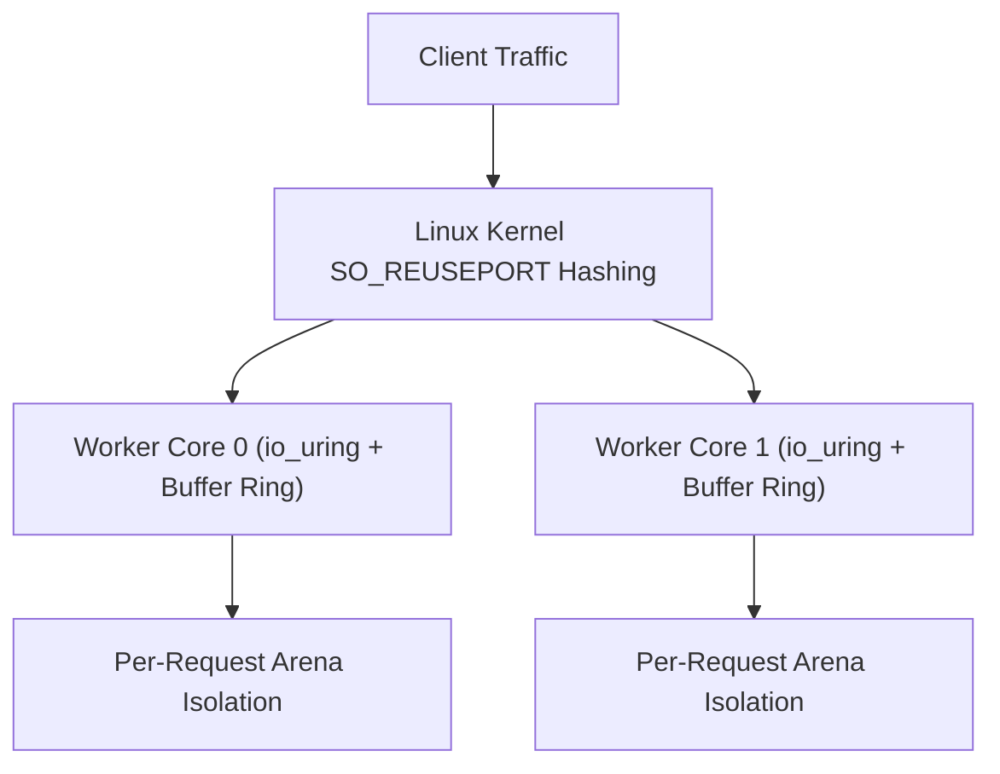

Trux features a high-performance HTTP engine engineered specifically for Linux servers. It is built natively on **`io_uring`** and **`liburing`**, departing from legacy `epoll` architectures and goroutine schedulers in favor of a shared-nothing, thread-per-core model.

## Architecture Highlights

- **Shared-Nothing Thread-per-Core**: Each hardware execution unit runs an independent worker thread. Every worker creates its own listening socket with `SO_REUSEPORT`, dedicated `io_uring` instance, and dedicated kernel buffer ring.
- **Kernel Buffer Rings (`io_uring_register_buf_ring`)**: The Linux kernel dynamically selects pre-registered buffers upon incoming network packets (`IOSQE_BUFFER_SELECT`), eliminating user-space memory allocations and read system calls.
- **Multishot Operations & Async Response Queuing**: A single Submission Queue Entry (SQE) establishes continuous connection acceptance (`io_uring_prep_multishot_accept`) and streaming receive (`io_uring_prep_recv_multishot`), while outgoing HTTP responses are queued asynchronously via `io_uring_prep_send` and flushed in batched ring submissions.
- **CPU Affinity Worker Sizing (`sched_getaffinity`)**: Worker threads automatically match the container or host CPU affinity mask (`CPU_COUNT`), maintaining a strict 1:1 thread-per-core mapping without over-spawning threads inside cgroup-constrained containers.
- **Predictable Memory Footprint**: Bounded buffer rings and request-scoped arenas keep memory consumption between **7.4 MiB and 55.9 MiB** regardless of concurrent connection counts.



---

## Test Environment & Methodology

Benchmarks were conducted using the standard HTTP benchmarking utility [`wrk`](https://github.com/wg/wrk) against containerized Trux servers run under strict Linux cgroup hardware limits:

- **Host OS & Kernel**: Ubuntu 24.04 LTS on Linux 6.18 (`x86_64`)
- **Container Runtime**: Docker Engine 29.1 (cgroup v2, `--security-opt seccomp=unconfined`, `--ulimit memlock=-1:-1`)
- **Libraries**: `liburing2` v2.5
- **Connections**: 100 and 1,000 persistent HTTP/1.1 keep-alive connections
- **Duration**: 6 seconds per scenario

### Workloads Evaluated

1. **Plaintext Baseline (`/plaintext`)**: Raw HTTP/1.1 framing and minimal response body (`"Hello, World!"`), measuring peak kernel network I/O with zero database overhead.
2. **JSON Serialization (`/json/serialize`)**: In-memory dynamic JSON document creation and serialization via native `yyjson` DOM builder, demonstrating arena allocation efficiency with nested keys and numbers.
3. **SQLite File Insert & Query (`/sqlite/insert-and-query`)**: Real on-disk SQLite WAL database file (`/tmp/bench.db`) write transaction: appends an access log entry (`INSERT INTO logs`), queries the latest row (`SELECT`), builds a JSON document via `json.MutDoc`, and serializes it.
4. **SQLite File Prepared Query (`/sqlite/query-by-id/1024`)**: Concurrent reads on disk: extracts route parameter (`:id`), compiles a prepared SQL statement (`SELECT name, role FROM users WHERE id = ?`), binds parameters (`bindText`), steps the cursor, builds a JSON document via `json.MutDoc`, and serializes it.
5. **Middleware & SQLite File Audit (`/api/authenticated-audit`)**: Prefix middleware (`useAt`), Bearer token validation, on-disk SQLite WAL audit log insertion, request-scoped context dictionary propagation, and privileged JSON response delivery via `json.MutDoc`.

---

## Benchmark Results

### 1. Micro Edge (1 vCPU, 256 MB RAM)

Simulates constrained edge environments, micro instances, or single-core serverless containers (`--cpuset-cpus="0" --cpus="1.0" --memory="256m"`).

| Endpoint | Concurrency | Throughput (req/s) | Transfer | Avg Latency | p50 | p90 | p99 | Memory |
| :--- | :---: | :---: | :---: | :---: | :---: | :---: | :---: | :---: |
| **Plaintext Baseline** (`/plaintext`) | 100 | **150,124** | 14.75 MB/s | 697 µs | 610 µs | 763 µs | 1.44 ms | 7.4 MiB |
| **Plaintext Baseline** (`/plaintext`) | 1,000 | **114,305** | 11.23 MB/s | 8.73 ms | 8.41 ms | 9.83 ms | 12.58 ms | 15.1 MiB |
| **JSON Serialization** (`/json/serialize`) | 100 | **149,968** | 22.17 MB/s | 633 µs | 608 µs | 775 µs | 1.21 ms | 14.8 MiB |
| **JSON Serialization** (`/json/serialize`) | 1,000 | **121,905** | 18.02 MB/s | 8.13 ms | 8.06 ms | 8.92 ms | 10.50 ms | 14.9 MiB |
| **SQLite File Insert & Query** (`/sqlite/insert-and-query`) | 100 | **63,155** | 10.06 MB/s | 3.08 ms | 1.24 ms | 8.32 ms | 24.22 ms | 31.1 MiB |
| **SQLite File Insert & Query** (`/sqlite/insert-and-query`) | 1,000 | **57,662** | 9.18 MB/s | 17.39 ms | 15.21 ms | 23.37 ms | 42.12 ms | 33.3 MiB |
| **SQLite File Prepared Query** (`/sqlite/query-by-id/1024`) | 100 | **126,580** | 16.78 MB/s | 753 µs | 724 µs | 910 µs | 1.35 ms | 34.3 MiB |
| **SQLite File Prepared Query** (`/sqlite/query-by-id/1024`) | 1,000 | **100,104** | 13.27 MB/s | 9.87 ms | 9.63 ms | 10.96 ms | 13.72 ms | 34.2 MiB |
| **Middleware & SQLite File Audit** (`/api/authenticated-audit`) | 100 | **66,870** | 8.80 MB/s | 2.84 ms | 1.16 ms | 8.18 ms | 22.14 ms | 34.2 MiB |
| **Middleware & SQLite File Audit** (`/api/authenticated-audit`) | 1,000 | **61,824** | 8.14 MB/s | 16.55 ms | 13.74 ms | 25.86 ms | 43.35 ms | 34.1 MiB |

---

### 2. Cloud Standard (2 vCPUs, 1 GB RAM)

Simulates standard dual-core virtual machines (`--cpuset-cpus="0,1" --cpus="2.0" --memory="1g"`).

| Endpoint | Concurrency | Throughput (req/s) | Transfer | Avg Latency | p50 | p90 | p99 | Memory |
| :--- | :---: | :---: | :---: | :---: | :---: | :---: | :---: | :---: |
| **Plaintext Baseline** (`/plaintext`) | 100 | **278,853** | 27.39 MB/s | 388 µs | 317 µs | 480 µs | 1.05 ms | 12.1 MiB |
| **Plaintext Baseline** (`/plaintext`) | 1,000 | **228,951** | 22.49 MB/s | 4.36 ms | 4.15 ms | 5.27 ms | 6.71 ms | 20.3 MiB |
| **JSON Serialization** (`/json/serialize`) | 100 | **266,365** | 39.37 MB/s | 368 µs | 330 µs | 506 µs | 1.00 ms | 20.7 MiB |
| **JSON Serialization** (`/json/serialize`) | 1,000 | **226,984** | 33.55 MB/s | 4.37 ms | 4.22 ms | 5.22 ms | 6.41 ms | 24.9 MiB |
| **SQLite File Insert & Query** (`/sqlite/insert-and-query`) | 100 | **85,280** | 13.58 MB/s | 4.50 ms | 900 µs | 15.59 ms | 47.50 ms | 27.3 MiB |
| **SQLite File Insert & Query** (`/sqlite/insert-and-query`) | 1,000 | **76,184** | 12.13 MB/s | 18.38 ms | 10.27 ms | 50.26 ms | 89.85 ms | 31.9 MiB |
| **SQLite File Prepared Query** (`/sqlite/query-by-id/1024`) | 100 | **193,071** | 25.59 MB/s | 498 µs | 463 µs | 690 µs | 1.24 ms | 32.0 MiB |
| **SQLite File Prepared Query** (`/sqlite/query-by-id/1024`) | 1,000 | **180,777** | 23.96 MB/s | 5.49 ms | 5.25 ms | 6.69 ms | 8.49 ms | 32.9 MiB |
| **Middleware & SQLite File Audit** (`/api/authenticated-audit`) | 100 | **90,254** | 11.88 MB/s | 4.79 ms | 827 µs | 17.95 ms | 48.56 ms | 33.6 MiB |
| **Middleware & SQLite File Audit** (`/api/authenticated-audit`) | 1,000 | **87,907** | 11.57 MB/s | 14.28 ms | 9.27 ms | 34.37 ms | 69.39 ms | 33.9 MiB |

---

### 3. Compute Node (4 vCPUs, 2 GB RAM)

Simulates multi-core production server nodes (`--cpuset-cpus="0,1,2,3" --cpus="4.0" --memory="2g"`).

| Endpoint | Concurrency | Throughput (req/s) | Transfer | Avg Latency | p50 | p90 | p99 | Memory |
| :--- | :---: | :---: | :---: | :---: | :---: | :---: | :---: | :---: |
| **Plaintext Baseline** (`/plaintext`) | 100 | **690,048** | 67.78 MB/s | 207 µs | 106 µs | 226 µs | 538 µs | 20.0 MiB |
| **Plaintext Baseline** (`/plaintext`) | 1,000 | **703,956** | 69.15 MB/s | 1.39 ms | 1.26 ms | 2.08 ms | 3.66 ms | 29.3 MiB |
| **JSON Serialization** (`/json/serialize`) | 100 | **675,776** | 99.89 MB/s | 143 µs | 111 µs | 221 µs | 467 µs | 29.8 MiB |
| **JSON Serialization** (`/json/serialize`) | 1,000 | **695,237** | 102.77 MB/s | 1.39 ms | 1.28 ms | 2.04 ms | 3.30 ms | 36.1 MiB |
| **SQLite File Insert & Query** (`/sqlite/insert-and-query`) | 100 | **59,584** | 9.49 MB/s | 3.75 ms | 1.36 ms | 4.56 ms | 43.06 ms | 38.0 MiB |
| **SQLite File Insert & Query** (`/sqlite/insert-and-query`) | 1,000 | **70,082** | 11.16 MB/s | 16.00 ms | 12.30 ms | 28.60 ms | 63.43 ms | 45.7 MiB |
| **SQLite File Prepared Query** (`/sqlite/query-by-id/1024`) | 100 | **250,387** | 33.19 MB/s | 378 µs | 330 µs | 642 µs | 1.01 ms | 45.3 MiB |
| **SQLite File Prepared Query** (`/sqlite/query-by-id/1024`) | 1,000 | **254,878** | 33.79 MB/s | 3.89 ms | 3.71 ms | 5.52 ms | 7.92 ms | 48.3 MiB |
| **Middleware & SQLite File Audit** (`/api/authenticated-audit`) | 100 | **59,644** | 7.85 MB/s | 3.88 ms | 1.36 ms | 4.74 ms | 44.85 ms | 49.1 MiB |
| **Middleware & SQLite File Audit** (`/api/authenticated-audit`) | 1,000 | **76,429** | 10.06 MB/s | 15.08 ms | 11.09 ms | 30.38 ms | 60.99 ms | 55.9 MiB |

---

## Analysis & Key Takeaways

### Realistic On-Disk Database Workloads
The benchmark operates against an actual persistent database file on disk (`/tmp/bench.db`) configured with SQLite's recommended Write-Ahead Logging mode (`PRAGMA journal_mode=WAL; PRAGMA synchronous=NORMAL; PRAGMA mmap_size=67108864; PRAGMA cache_size=-16384;`).

### Thread-Local Connections & Persistent Prepared Statement Cache
Handlers utilize thread-local connection caching (`sqlite.openThreadLocal`) paired with a transparent per-connection prepared statement cache (`sqlite3_prepare_v3` with `SQLITE_PREPARE_PERSISTENT`):
- **Zero File Descriptor or Parser Churn**: Eliminates file open/close syscalls, SQL lexing, AST parsing, and VDBE compilation on repeated requests.
- **Lock-Free Concurrency (`SQLITE_THREADSAFE=2`)**: Because each worker thread owns its connection handle exclusively, SQLite runs in multi-thread mode without per-call recursive connection mutexes (`db->mutex`) or global memory-tracking locks (`SQLITE_DEFAULT_MEMSTATUS=0`).
- **Single-Roundtrip Write+Read (`INSERT ... RETURNING`)**: `/sqlite/insert-and-query` inserts and retrieves the new row in a single VDBE execution without a secondary B-tree lookup.

### Concurrent Readers vs. High-Throughput WAL Writes
- **High-Throughput Reads (`/sqlite/query-by-id/1024`)**: Parameterized prepared queries scale up to **254,878 req/s** on disk with a **7.92 ms** p99 latency at 1,000 concurrency across 4 cores (**250,387 req/s** with **1.01 ms** p99 at 100 concurrency).
- **High-Throughput WAL Writes (`/sqlite/insert-and-query`, `/api/authenticated-audit`)**: Combining `PRAGMA synchronous=NORMAL`, persistent statement caching, CPU-affinity worker sizing (`sched_getaffinity`), and memory-scaled (2,000–20,000 frame) `SQLITE_CHECKPOINT_TRUNCATE` checkpoints sustains **59,584 to 90,254 writes/sec** with **827 µs–1.36 ms** median latency at 100 concurrency and zero lock errors.
- **Async `io_uring_prep_send` & Batched CQE Draining**: Worker threads drain all ready completion queue entries (`io_uring_for_each_cqe`) and queue HTTP responses via `io_uring_prep_send`, coalescing network I/O into batched ring submissions.

### Low Memory Footprint Under Continuous I/O
Matching worker threads to container CPU affinity (`1`, `2`, and `4` workers) and bounding `/tmp/bench.db-wal` via truncating checkpoints keeps total container memory between **7.4 MiB and 55.9 MiB** across millions of database reads and writes.

---

## Reproducing the Benchmarks

The benchmark harness and server source code are located in `benchmarks/http/`:

```bash
# Compile and run the benchmark suite against Docker containers
python3 benchmarks/http/benchmark.py
```

The script compiles the Trux HTTP server, builds the runtime Docker container, executes `wrk` across all hardware profiles, and generates `BENCHMARK_RESULTS.md` and `results.json`.

## Handwritten digits on the GPU

`benchmarks/digits` times `POST /predict` for the handwritten-digits SVM. The server mounts a TXM1 file once, then each request launches one RBF kernel and reuses that device memory. The default file has the notebook shape: 519 support vectors, 64 features, gamma 0.001.

```bash
make bench-digits
```

The target needs Linux, liburing, and CUDA. It is separate from `make bench` and from the cgroup matrix above. The harness prints throughput and latency for that machine. Those numbers are not checked in.
