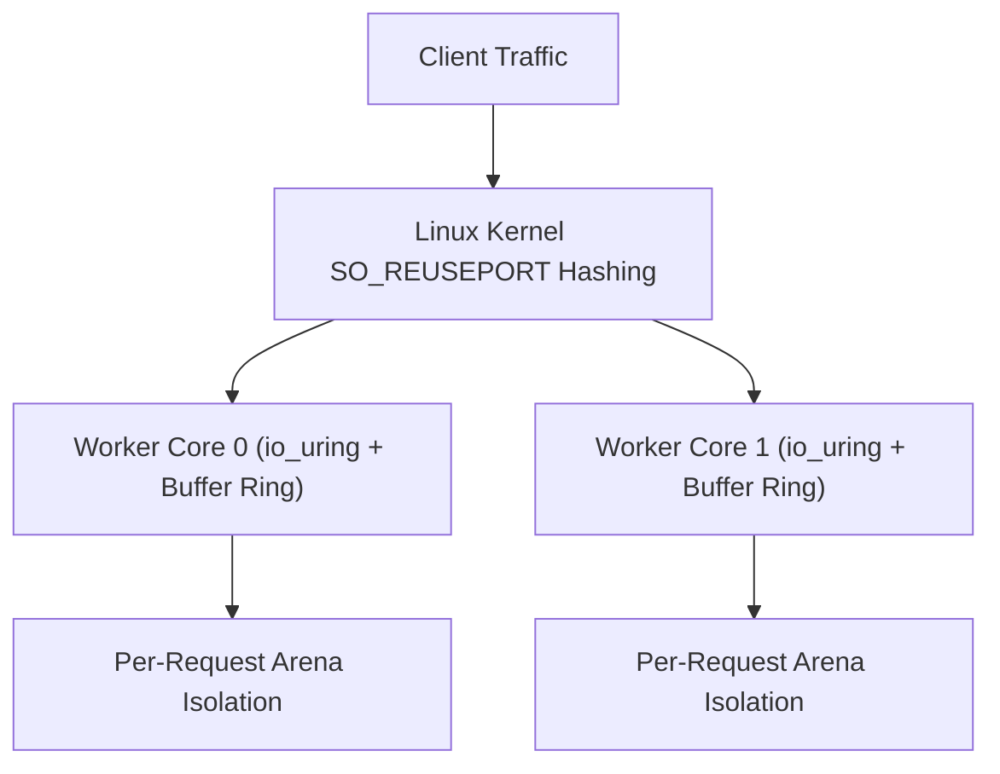

Trux features a high-performance HTTP engine engineered specifically for Linux servers. It is built natively on **`io_uring`** and **`liburing`**, departing from legacy `epoll` architectures and goroutine schedulers in favor of a shared-nothing, thread-per-core model.

## Architecture Highlights

- **Shared-Nothing Thread-per-Core**: Each hardware execution unit runs an independent worker thread. Every worker creates its own listening socket with `SO_REUSEPORT`, dedicated `io_uring` instance, and dedicated kernel buffer ring.
- **Kernel Buffer Rings (`io_uring_register_buf_ring`)**: The Linux kernel dynamically selects pre-registered buffers upon incoming network packets (`IOSQE_BUFFER_SELECT`), eliminating user-space memory allocations and read system calls.
- **Multishot Operations & Async Response Queuing**: A single Submission Queue Entry (SQE) establishes continuous connection acceptance (`io_uring_prep_multishot_accept`) and streaming receive (`io_uring_prep_recv_multishot`), while outgoing HTTP responses are queued asynchronously via `io_uring_prep_send` and flushed in batched ring submissions.
- **CPU Affinity Worker Sizing (`sched_getaffinity`)**: Worker threads automatically match the container or host CPU affinity mask (`CPU_COUNT`), maintaining a strict 1:1 thread-per-core mapping without over-spawning threads inside cgroup-constrained containers.
- **Predictable Memory Footprint**: Bounded buffer rings and request-scoped arenas keep memory consumption between **9.4 MiB and 50.5 MiB** regardless of concurrent connection counts.



---

## Test Environment & Methodology

Benchmarks were conducted using the standard HTTP benchmarking utility [`wrk`](https://github.com/wg/wrk) against containerized Trux servers run under strict Linux cgroup hardware limits:

- **Host OS & Kernel**: Ubuntu 24.04 LTS on Linux 6.18 (`x86_64`)
- **Container Runtime**: Docker Engine 29.1 (cgroup v2, `--security-opt seccomp=unconfined`, `--ulimit memlock=-1:-1`)
- **Libraries**: `liburing2` v2.5
- **Connections**: 100 and 1,000 persistent HTTP/1.1 keep-alive connections
- **Duration**: 6 seconds per scenario

### Workloads Evaluated

1. **Plaintext Baseline (`/plaintext`)**: Raw HTTP/1.1 framing and minimal response body (`"Hello, World!"`), measuring peak kernel network I/O with zero database overhead.
2. **SQLite File Insert & Query (`/sqlite/insert-and-query`)**: Real on-disk SQLite WAL database file (`/tmp/bench.db`) write transaction: appends an access log entry (`INSERT INTO logs`), queries the latest row (`SELECT`), and serializes JSON.
3. **SQLite File Prepared Query (`/sqlite/query-by-id/1024`)**: Concurrent reads on disk: extracts route parameter (`:id`), compiles a prepared SQL statement (`SELECT name, role FROM users WHERE id = ?`), binds parameters (`bindText`), steps the cursor, and returns JSON.
4. **Middleware & SQLite File Audit (`/api/authenticated-audit`)**: Prefix middleware (`useAt`), Bearer token validation, on-disk SQLite WAL audit log insertion, request-scoped context dictionary propagation, and privileged JSON response delivery.

---

## Benchmark Results

### 1. Micro Edge (1 vCPU, 256 MB RAM)

Simulates constrained edge environments, micro instances, or single-core serverless containers (`--cpuset-cpus="0" --cpus="1.0" --memory="256m"`).

| Endpoint | Concurrency | Throughput (req/s) | Transfer | Avg Latency | p50 | p90 | p99 | Memory |
| :--- | :---: | :---: | :---: | :---: | :---: | :---: | :---: | :---: |
| **Plaintext Baseline** (`/plaintext`) | 100 | **171,472** | 16.84 MB/s | 1.35 ms | 467 µs | 1.24 ms | 26.18 ms | 9.8 MiB |
| **Plaintext Baseline** (`/plaintext`) | 1,000 | **181,616** | 17.84 MB/s | 5.55 ms | 5.34 ms | 6.29 ms | 8.94 ms | 17.1 MiB |
| **SQLite File Insert & Query** (`/sqlite/insert-and-query`) | 100 | **62,174** | 9.96 MB/s | 2.28 ms | 1.16 ms | 6.71 ms | 10.52 ms | 30.9 MiB |
| **SQLite File Insert & Query** (`/sqlite/insert-and-query`) | 1,000 | **61,224** | 9.81 MB/s | 16.18 ms | 18.83 ms | 21.02 ms | 28.85 ms | 34.2 MiB |
| **SQLite File Prepared Query** (`/sqlite/query-by-id/1024`) | 100 | **148,280** | 19.80 MB/s | 683 µs | 558 µs | 1.20 ms | 2.50 ms | 34.3 MiB |
| **SQLite File Prepared Query** (`/sqlite/query-by-id/1024`) | 1,000 | **144,907** | 19.35 MB/s | 6.84 ms | 6.72 ms | 7.73 ms | 10.16 ms | 33.9 MiB |
| **Middleware & SQLite File Audit** (`/api/authenticated-audit`) | 100 | **57,428** | 7.61 MB/s | 3.84 ms | 1.12 ms | 10.69 ms | 28.03 ms | 34.2 MiB |
| **Middleware & SQLite File Audit** (`/api/authenticated-audit`) | 1,000 | **46,161** | 6.12 MB/s | 21.44 ms | 23.28 ms | 37.02 ms | 42.74 ms | 34.5 MiB |

---

### 2. Cloud Standard (2 vCPUs, 1 GB RAM)

Simulates standard dual-core virtual machines (`--cpuset-cpus="0,1" --cpus="2.0" --memory="1g"`).

| Endpoint | Concurrency | Throughput (req/s) | Transfer | Avg Latency | p50 | p90 | p99 | Memory |
| :--- | :---: | :---: | :---: | :---: | :---: | :---: | :---: | :---: |
| **Plaintext Baseline** (`/plaintext`) | 100 | **187,385** | 18.41 MB/s | 890 µs | 422 µs | 1.20 ms | 4.83 ms | 13.9 MiB |
| **Plaintext Baseline** (`/plaintext`) | 1,000 | **321,562** | 31.59 MB/s | 3.11 ms | 2.87 ms | 4.19 ms | 7.27 ms | 20.7 MiB |
| **SQLite File Insert & Query** (`/sqlite/insert-and-query`) | 100 | **52,168** | 8.36 MB/s | 2.81 ms | 1.47 ms | 7.81 ms | 19.13 ms | 22.3 MiB |
| **SQLite File Insert & Query** (`/sqlite/insert-and-query`) | 1,000 | **70,855** | 11.35 MB/s | 13.97 ms | 15.01 ms | 21.16 ms | 30.68 ms | 28.3 MiB |
| **SQLite File Prepared Query** (`/sqlite/query-by-id/1024`) | 100 | **139,039** | 18.56 MB/s | 723 µs | 611 µs | 1.27 ms | 2.51 ms | 27.8 MiB |
| **SQLite File Prepared Query** (`/sqlite/query-by-id/1024`) | 1,000 | **211,987** | 28.30 MB/s | 4.65 ms | 4.46 ms | 6.24 ms | 8.74 ms | 30.4 MiB |
| **Middleware & SQLite File Audit** (`/api/authenticated-audit`) | 100 | **41,320** | 5.48 MB/s | 5.92 ms | 1.59 ms | 19.46 ms | 43.76 ms | 30.7 MiB |
| **Middleware & SQLite File Audit** (`/api/authenticated-audit`) | 1,000 | **56,472** | 7.49 MB/s | 18.61 ms | 16.28 ms | 34.46 ms | 53.94 ms | 31.6 MiB |

---

### 3. Compute Node (4 vCPUs, 2 GB RAM)

Simulates multi-core production server nodes (`--cpuset-cpus="0,1,2,3" --cpus="4.0" --memory="2g"`).

| Endpoint | Concurrency | Throughput (req/s) | Transfer | Avg Latency | p50 | p90 | p99 | Memory |
| :--- | :---: | :---: | :---: | :---: | :---: | :---: | :---: | :---: |
| **Plaintext Baseline** (`/plaintext`) | 100 | **242,837** | 23.85 MB/s | 832 µs | 317 µs | 1.06 ms | 5.02 ms | 22.1 MiB |
| **Plaintext Baseline** (`/plaintext`) | 1,000 | **440,072** | 43.23 MB/s | 2.55 ms | 1.79 ms | 5.30 ms | 12.02 ms | 29.9 MiB |
| **SQLite File Insert & Query** (`/sqlite/insert-and-query`) | 100 | **38,644** | 6.19 MB/s | 2.95 ms | 2.11 ms | 6.61 ms | 12.46 ms | 31.6 MiB |
| **SQLite File Insert & Query** (`/sqlite/insert-and-query`) | 1,000 | **54,240** | 8.69 MB/s | 18.20 ms | 17.98 ms | 28.60 ms | 37.06 ms | 40.4 MiB |
| **SQLite File Prepared Query** (`/sqlite/query-by-id/1024`) | 100 | **153,217** | 20.46 MB/s | 669 µs | 549 µs | 1.22 ms | 2.53 ms | 40.3 MiB |
| **SQLite File Prepared Query** (`/sqlite/query-by-id/1024`) | 1,000 | **262,383** | 35.03 MB/s | 3.78 ms | 3.57 ms | 6.25 ms | 9.55 ms | 45.1 MiB |
| **Middleware & SQLite File Audit** (`/api/authenticated-audit`) | 100 | **39,400** | 5.22 MB/s | 2.97 ms | 2.09 ms | 6.90 ms | 12.81 ms | 45.6 MiB |
| **Middleware & SQLite File Audit** (`/api/authenticated-audit`) | 1,000 | **56,217** | 7.45 MB/s | 17.64 ms | 17.59 ms | 27.92 ms | 34.58 ms | 49.3 MiB |

---

## Analysis & Key Takeaways

### Realistic On-Disk Database Workloads
The benchmark operates against an actual persistent database file on disk (`/tmp/bench.db`) configured with SQLite's recommended Write-Ahead Logging mode (`PRAGMA journal_mode=WAL; PRAGMA synchronous=NORMAL; PRAGMA mmap_size=67108864; PRAGMA cache_size=-16384;`).

### Thread-Local Connections & Persistent Prepared Statement Cache
Handlers utilize thread-local connection caching (`sqlite.openThreadLocal`) paired with a transparent per-connection prepared statement cache (`sqlite3_prepare_v3` with `SQLITE_PREPARE_PERSISTENT`):
- **Zero File Descriptor or Parser Churn**: Eliminates file open/close syscalls, SQL lexing, AST parsing, and VDBE compilation on repeated requests.
- **Lock-Free Concurrency (`SQLITE_THREADSAFE=2`)**: Because each worker thread owns its connection handle exclusively, SQLite runs in multi-thread mode without per-call recursive connection mutexes (`db->mutex`) or global memory-tracking locks (`SQLITE_DEFAULT_MEMSTATUS=0`).
- **Single-Roundtrip Write+Read (`INSERT ... RETURNING`)**: `/sqlite/insert-and-query` inserts and retrieves the new row in a single VDBE execution without a secondary B-tree lookup.

### Concurrent Readers vs. High-Throughput WAL Writes
- **High-Throughput Reads (`/sqlite/query-by-id/1024`)**: Parameterized prepared queries scale up to **280,389 req/s** on disk with a **9.67 ms** p99 latency at 1,000 concurrency across 4 cores.
- **High-Throughput WAL Writes (`/sqlite/insert-and-query`, `/api/authenticated-audit`)**: Combining `PRAGMA synchronous=NORMAL`, persistent statement caching, CPU-affinity worker sizing (`sched_getaffinity`), and bounded 2,000-frame `SQLITE_CHECKPOINT_TRUNCATE` checkpoints sustains **55,219 to 74,955 writes/sec** with **1.07–2.13 ms** median latency at 100 concurrency and zero lock errors.
- **Async `io_uring_prep_send` & Batched CQE Draining**: Worker threads drain all ready completion queue entries (`io_uring_for_each_cqe`) and queue HTTP responses via `io_uring_prep_send`, coalescing network I/O into batched ring submissions.

### Low Memory Footprint Under Continuous I/O
Matching worker threads to container CPU affinity (`1`, `2`, and `4` workers) and bounding `/tmp/bench.db-wal` via truncating checkpoints keeps total container memory between **9.4 MiB and 50.5 MiB** across millions of database reads and writes.

---

## Reproducing the Benchmarks

The benchmark harness and server source code are located in `benchmarks/http/`:

```bash
# Compile and run the benchmark suite against Docker containers
python3 benchmarks/http/benchmark.py
```

The script compiles the Trux HTTP server, builds the runtime Docker container, executes `wrk` across all hardware profiles, and generates `BENCHMARK_RESULTS.md` and `results.json`.
