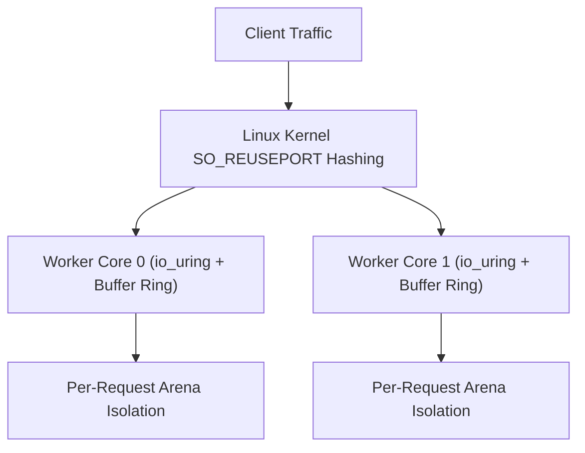

Trux features a high-performance HTTP engine engineered specifically for Linux servers. It is built natively on **`io_uring`** and **`liburing`**, departing from legacy `epoll` architectures and goroutine schedulers in favor of a shared-nothing, thread-per-core model.

## Architecture Highlights

- **Shared-Nothing Thread-per-Core**: Each hardware execution unit runs an independent worker thread. Every worker creates its own listening socket with `SO_REUSEPORT`, dedicated `io_uring` instance, and dedicated kernel buffer ring.
- **Kernel Buffer Rings (`io_uring_register_buf_ring`)**: The Linux kernel dynamically selects pre-registered buffers upon incoming network packets (`IOSQE_BUFFER_SELECT`), eliminating user-space memory allocations and read system calls.
- **Multishot Operations & Async Response Queuing**: A single Submission Queue Entry (SQE) establishes continuous connection acceptance (`io_uring_prep_multishot_accept`) and streaming receive (`io_uring_prep_recv_multishot`), while outgoing HTTP responses are queued asynchronously via `io_uring_prep_send` and flushed in batched ring submissions.
- **CPU Affinity Worker Sizing (`sched_getaffinity`)**: Worker threads automatically match the container or host CPU affinity mask (`CPU_COUNT`), maintaining a strict 1:1 thread-per-core mapping without over-spawning threads inside cgroup-constrained containers.
- **Predictable Memory Footprint**: Bounded buffer rings and request-scoped arenas keep memory consumption between **6.0 MiB and 51.8 MiB** regardless of concurrent connection counts.



---

## Test Environment & Methodology

Benchmarks were conducted using the standard HTTP benchmarking utility [`wrk`](https://github.com/wg/wrk) against containerized Trux servers run under strict Linux cgroup hardware limits:

- **Host OS & Kernel**: Linux Mint 22.3, kernel 7.0.0-38-generic (`x86_64`)
- **Container Runtime**: Docker Engine 29.9.0 (cgroup v2, `--security-opt seccomp=unconfined`, `--ulimit memlock=-1:-1`)
- **Libraries**: `liburing2` v2.5
- **Connections**: 100 and 1,000 persistent HTTP/1.1 keep-alive connections
- **Duration**: 6 seconds per scenario

### Workloads Evaluated

1. **Plaintext Baseline (`/plaintext`)**: Raw HTTP/1.1 framing and minimal response body (`"Hello, World!"`), measuring peak kernel network I/O with zero database overhead.
2. **JSON Serialization (`/json/serialize`)**: In-memory dynamic JSON document creation and serialization via native `yyjson` DOM builder, demonstrating arena allocation efficiency with nested keys and numbers.
3. **SQLite File Insert & Query (`/sqlite/insert-and-query`)**: Real on-disk SQLite WAL database file (`/tmp/bench.db`) write transaction: appends an access log entry (`INSERT INTO logs`), queries the latest row (`SELECT`), builds a JSON document via `json.MutDoc`, and serializes it.
4. **SQLite File Prepared Query (`/sqlite/query-by-id/1024`)**: Concurrent reads on disk: extracts route parameter (`:id`), compiles a prepared SQL statement (`SELECT name, role FROM users WHERE id = ?`), binds parameters (`bindText`), steps the cursor, builds a JSON document via `json.MutDoc`, and serializes it.
5. **Middleware & SQLite File Audit (`/api/authenticated-audit`)**: Prefix middleware (`useAt`), Bearer token validation, on-disk SQLite WAL audit log insertion, request-scoped context dictionary propagation, and privileged JSON response delivery via `json.MutDoc`.

---

## Benchmark Results

### 1. Micro Edge (1 vCPU, 256 MB RAM)

Simulates constrained edge environments, micro instances, or single-core serverless containers (`--cpuset-cpus="0" --cpus="1.0" --memory="256m"`).

| Endpoint | Concurrency | Throughput (req/s) | Transfer | Avg Latency | p50 | p90 | p99 | Memory |
| :--- | :---: | :---: | :---: | :---: | :---: | :---: | :---: | :---: |
| **Plaintext Baseline** (`/plaintext`) | 100 | **140,731** | 13.82 MB/s | 694 µs | 655 µs | 805 µs | 1.11 ms | 6.0 MiB |
| **Plaintext Baseline** (`/plaintext`) | 1,000 | **118,127** | 11.60 MB/s | 8.45 ms | 8.19 ms | 9.72 ms | 12.72 ms | 14.0 MiB |
| **JSON Serialization** (`/json/serialize`) | 100 | **137,110** | 20.27 MB/s | 698 µs | 684 µs | 787 µs | 1.04 ms | 13.8 MiB |
| **JSON Serialization** (`/json/serialize`) | 1,000 | **120,816** | 17.86 MB/s | 8.20 ms | 7.99 ms | 9.70 ms | 12.51 ms | 13.6 MiB |
| **SQLite File Insert & Query** (`/sqlite/insert-and-query`) | 100 | **42,425** | 6.76 MB/s | 3.87 ms | 1.92 ms | 8.32 ms | 29.93 ms | 24.6 MiB |
| **SQLite File Insert & Query** (`/sqlite/insert-and-query`) | 1,000 | **39,821** | 6.34 MB/s | 24.91 ms | 21.66 ms | 40.37 ms | 52.57 ms | 31.2 MiB |
| **SQLite File Prepared Query** (`/sqlite/query-by-id/1024`) | 100 | **105,662** | 14.01 MB/s | 900 µs | 900 µs | 990 µs | 1.19 ms | 31.3 MiB |
| **SQLite File Prepared Query** (`/sqlite/query-by-id/1024`) | 1,000 | **85,923** | 11.39 MB/s | 11.53 ms | 11.35 ms | 13.13 ms | 16.78 ms | 31.4 MiB |
| **Middleware & SQLite File Audit** (`/api/authenticated-audit`) | 100 | **44,721** | 5.89 MB/s | 3.83 ms | 1.81 ms | 9.27 ms | 29.61 ms | 31.8 MiB |
| **Middleware & SQLite File Audit** (`/api/authenticated-audit`) | 1,000 | **40,099** | 5.28 MB/s | 24.92 ms | 21.46 ms | 48.27 ms | 54.93 ms | 32.6 MiB |

---

### 2. Cloud Standard (2 vCPUs, 1 GB RAM)

Simulates standard dual-core virtual machines (`--cpuset-cpus="0,1" --cpus="2.0" --memory="1g"`).

| Endpoint | Concurrency | Throughput (req/s) | Transfer | Avg Latency | p50 | p90 | p99 | Memory |
| :--- | :---: | :---: | :---: | :---: | :---: | :---: | :---: | :---: |
| **Plaintext Baseline** (`/plaintext`) | 100 | **252,505** | 24.80 MB/s | 410 µs | 371 µs | 445 µs | 558 µs | 10.3 MiB |
| **Plaintext Baseline** (`/plaintext`) | 1,000 | **247,527** | 24.31 MB/s | 4.06 ms | 3.92 ms | 4.73 ms | 6.10 ms | 18.8 MiB |
| **JSON Serialization** (`/json/serialize`) | 100 | **246,800** | 36.48 MB/s | 386 µs | 374 µs | 456 µs | 579 µs | 18.8 MiB |
| **JSON Serialization** (`/json/serialize`) | 1,000 | **240,009** | 35.48 MB/s | 4.14 ms | 4.06 ms | 4.78 ms | 6.03 ms | 23.2 MiB |
| **SQLite File Insert & Query** (`/sqlite/insert-and-query`) | 100 | **50,121** | 7.98 MB/s | 4.89 ms | 1.57 ms | 8.46 ms | 53.90 ms | 26.2 MiB |
| **SQLite File Insert & Query** (`/sqlite/insert-and-query`) | 1,000 | **47,623** | 7.58 MB/s | 24.59 ms | 17.92 ms | 51.95 ms | 101.11 ms | 28.7 MiB |
| **SQLite File Prepared Query** (`/sqlite/query-by-id/1024`) | 100 | **170,164** | 22.56 MB/s | 571 µs | 559 µs | 757 µs | 1.05 ms | 28.7 MiB |
| **SQLite File Prepared Query** (`/sqlite/query-by-id/1024`) | 1,000 | **162,594** | 21.55 MB/s | 6.10 ms | 5.95 ms | 7.16 ms | 9.14 ms | 28.9 MiB |
| **Middleware & SQLite File Audit** (`/api/authenticated-audit`) | 100 | **50,665** | 6.67 MB/s | 6.35 ms | 1.51 ms | 19.34 ms | 70.40 ms | 29.1 MiB |
| **Middleware & SQLite File Audit** (`/api/authenticated-audit`) | 1,000 | **51,285** | 6.75 MB/s | 21.45 ms | 16.75 ms | 36.53 ms | 76.06 ms | 30.9 MiB |

---

### 3. Compute Node (4 vCPUs, 2 GB RAM)

Simulates multi-core production server nodes (`--cpuset-cpus="0,1,2,3" --cpus="4.0" --memory="2g"`).

| Endpoint | Concurrency | Throughput (req/s) | Transfer | Avg Latency | p50 | p90 | p99 | Memory |
| :--- | :---: | :---: | :---: | :---: | :---: | :---: | :---: | :---: |
| **Plaintext Baseline** (`/plaintext`) | 100 | **469,148** | 46.08 MB/s | 215 µs | 195 µs | 263 µs | 342 µs | 18.9 MiB |
| **Plaintext Baseline** (`/plaintext`) | 1,000 | **466,623** | 45.84 MB/s | 2.12 ms | 2.06 ms | 2.58 ms | 3.18 ms | 27.5 MiB |
| **JSON Serialization** (`/json/serialize`) | 100 | **463,319** | 68.49 MB/s | 207 µs | 199 µs | 270 µs | 342 µs | 28.6 MiB |
| **JSON Serialization** (`/json/serialize`) | 1,000 | **456,498** | 67.48 MB/s | 2.17 ms | 2.15 ms | 2.61 ms | 3.08 ms | 34.0 MiB |
| **SQLite File Insert & Query** (`/sqlite/insert-and-query`) | 100 | **44,199** | 7.04 MB/s | 5.73 ms | 1.85 ms | 8.69 ms | 63.92 ms | 37.4 MiB |
| **SQLite File Insert & Query** (`/sqlite/insert-and-query`) | 1,000 | **46,802** | 7.45 MB/s | 23.93 ms | 18.61 ms | 42.61 ms | 92.56 ms | 43.5 MiB |
| **SQLite File Prepared Query** (`/sqlite/query-by-id/1024`) | 100 | **271,051** | 35.93 MB/s | 370 µs | 340 µs | 436 µs | 1.45 ms | 42.9 MiB |
| **SQLite File Prepared Query** (`/sqlite/query-by-id/1024`) | 1,000 | **267,936** | 35.52 MB/s | 3.70 ms | 3.61 ms | 4.60 ms | 7.88 ms | 46.4 MiB |
| **Middleware & SQLite File Audit** (`/api/authenticated-audit`) | 100 | **46,239** | 6.09 MB/s | 6.75 ms | 1.75 ms | 19.49 ms | 73.64 ms | 47.5 MiB |
| **Middleware & SQLite File Audit** (`/api/authenticated-audit`) | 1,000 | **50,856** | 6.69 MB/s | 21.81 ms | 17.16 ms | 38.31 ms | 81.20 ms | 51.8 MiB |

---

## Analysis & Key Takeaways

### Realistic On-Disk Database Workloads
The benchmark operates against an actual persistent database file on disk (`/tmp/bench.db`) configured with SQLite's recommended Write-Ahead Logging mode (`PRAGMA journal_mode=WAL; PRAGMA synchronous=NORMAL; PRAGMA mmap_size=67108864; PRAGMA cache_size=-16384;`).

### Thread-Local Connections & Persistent Prepared Statement Cache
Handlers utilize thread-local connection caching (`sqlite.openThreadLocal`) paired with a transparent per-connection prepared statement cache (`sqlite3_prepare_v3` with `SQLITE_PREPARE_PERSISTENT`):
- **Zero File Descriptor or Parser Churn**: Eliminates file open/close syscalls, SQL lexing, AST parsing, and VDBE compilation on repeated requests.
- **Lock-Free Concurrency (`SQLITE_THREADSAFE=2`)**: Because each worker thread owns its connection handle exclusively, SQLite runs in multi-thread mode without per-call recursive connection mutexes (`db->mutex`) or global memory-tracking locks (`SQLITE_DEFAULT_MEMSTATUS=0`).
- **Single-Roundtrip Write+Read (`INSERT ... RETURNING`)**: `/sqlite/insert-and-query` inserts and retrieves the new row in a single VDBE execution without a secondary B-tree lookup.

### Concurrent Readers vs. High-Throughput WAL Writes
- **High-Throughput Reads (`/sqlite/query-by-id/1024`)**: Parameterized prepared queries reach **271,051 req/s** on disk with a **1.45 ms** p99 latency at 100 concurrency across 4 cores (**267,936 req/s** with a **7.88 ms** p99 at 1,000 concurrency).
- **High-Throughput WAL Writes (`/sqlite/insert-and-query`, `/api/authenticated-audit`)**: Combining `PRAGMA synchronous=NORMAL`, persistent statement caching, CPU-affinity worker sizing (`sched_getaffinity`), and memory-scaled (2,000–20,000 frame) `SQLITE_CHECKPOINT_TRUNCATE` checkpoints sustains **42,425 to 50,665 writes/sec** with **1.51 ms–1.92 ms** median latency at 100 concurrency and zero lock errors.
- **Async `io_uring_prep_send` & Batched CQE Draining**: Worker threads drain all ready completion queue entries (`io_uring_for_each_cqe`) and queue HTTP responses via `io_uring_prep_send`, coalescing network I/O into batched ring submissions.

### Low Memory Footprint Under Continuous I/O
Matching worker threads to container CPU affinity (`1`, `2`, and `4` workers) and bounding `/tmp/bench.db-wal` via truncating checkpoints keeps total container memory between **6.0 MiB and 51.8 MiB** across millions of database reads and writes.

---

## Reproducing the Benchmarks

The benchmark harness and server source code are located in `benchmarks/http/`:

```bash
# Compile and run the benchmark suite against Docker containers
python3 benchmarks/http/benchmark.py
```

The script compiles the Trux HTTP server, builds the runtime Docker container, executes `wrk` across all hardware profiles, and generates `BENCHMARK_RESULTS.md` and `results.json`.

## Handwritten digits on the GPU

`benchmarks/digits` times `POST /predict` for the handwritten-digits SVM. The server mounts a TXM1 file once, then each request launches one RBF kernel and reuses that device memory. The default file has the notebook shape: 519 support vectors, 64 features, gamma 0.001.

```bash
make bench-digits
```

The target needs Linux, liburing, and CUDA. It is separate from `make bench` and from the cgroup matrix above. Measured results for this path are on the [HTTP + GPU](/docs/benchmarks/http-gpu/) page.
